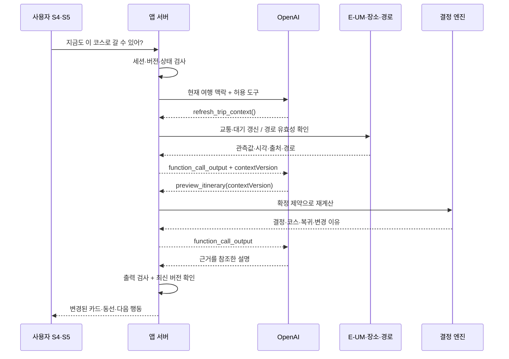

# RUN2구룡포: 사용자 동작·AI Agent·외부 API 상세 명세

> 서울에서 기차로 온 10km 참가자가 완주 후 구룡포를 방문하고 포항역으로 복귀하는 경험을, 구현하고 검증할 수 있는 단위로 정의한다.

작성일: 2026-10-06. [사용자 여정 기획서](run2-guryongpo-hackathon-journey.md)의 기술 상세본이다. **사용자 1명·화면 5개·버스 기본·사용자 선택 시 구간별 택시**를 유지한다. 아래 내부 API·도구·데이터 구조는 구현 제안이며, 외부 API 실호출·키 승인·서비스 배포를 완료했다는 뜻이 아니다.

## 1. 해커톤 요건과 멘토 피드백을 반영한 결정

### 1.1 요구의 출처와 구현 증거

대회 공식 소개의 목적은 구룡포 디지털 트윈 데이터로 지역 문제를 해결하는, 실제 동작하는 AI Agent 프로토타입이다. 공개된 30·25·25·20점 배점은 **서면평가 기준**이며 본선 배점으로 단정하지 않는다. [대회 공식 안내](https://dtaiagent.imweb.me/)

| 요구 | 근거·구분 | 이번 기획에서의 구현 | 시연·검증 증거 |
| --- | --- | --- | --- |
| 구룡포 디지털 트윈 데이터 사용 | 사용자 명시 필수, 공식 대회 목적. 레포 집필 브리프에는 최소 1개 실호출로 정리 | **E-UM 교통·대기 2종을 팀 구현 필수**로 채택 | 응답 성공, 실제 관측·조회 시각, 적용 장비·범위, 결정에 사용한 필드 |
| 자연어를 이해하고 응답하는 생성형 AI | 레포 집필 브리프의 Agent 요건, 사용자 요청의 OpenAI API | OpenAI Responses API로 요청 해석 → 제한된 도구 호출 → 결과 설명 | 실제 자연어 입력, function call, 앱이 실행한 결과, 최종 카드 |
| 질문 답변을 넘어 문제 해결 | 대회 목적·집필 브리프 | 코스·이동수단 비교, 귀가 계산, 변경 사항 시각화 | 같은 사용자의 요청 또는 관측 변화로 일정과 다음 행동 변경 |
| 지역사회 기여 | 공식 평가 관점, 멘토 자료 12절 | 대회 방문객의 구룡포 식사·관광·체류로 연결 | 후보 저장·구룡포행 길찾기·자기보고 도착·현지 다음 장소 이벤트 |
| 주제 유지·완결성 | 멘토 자료 12~14절 | 기존 완주자 관광 재계산 주제를 유지하고 기차 이용자 1명으로 구체화 | S1~S5 연결, 역 복귀까지 완결, 장애 시 대체 상태 |

**구분:** E-UM 2종 사용은 기존 제출안과 멘토 피드백을 반영한 팀 구현 기준이다. 모든 참가팀에 2종이 의무라는 뜻은 아니다. OpenAI는 이번 프로젝트의 지정 구현 수단이며, 대회가 특정 벤더만 허용한다고 해석하지 않는다.

### 1.2 멘토 피드백의 채택·수정

읽은 자료: 첨부 `PDAO-RUN2구룡포.html`, 「2026 디지털 트윈 구룡포 AI 해커톤 · 1차 멘토링」. 첨부는 `.context/attachments/QFz4mC/`에 있고 Git에는 포함하지 않는다. 아래는 원문 6~14절 중 이번 설계에 필요한 반영 요약이다.

| 피드백 | 반영 결정 |
| --- | --- |
| E-UM 실제 호출과 관측값 변화에 따른 결정 변화 | **채택.** 앞선 축소안의 ‘1종 우선’에서 교통·대기 2종으로 복원. 관측 변화 단독 시나리오 추가 |
| 규칙이 결정하고 LLM이 설명 | **유지·보강.** LLM은 자연어 이해와 조회·재계산 도구 선택도 수행. 시간·운영시간·보행·중단 조건은 서버가 최종 검사 |
| 자연어 제약 추출, 이유 질의응답 | **채택.** 빠른 폼은 유지하고 S4·S5에 현재 여행에 한정한 입력창 추가 |
| 자가용, 대회장 주차장 복귀 | **변경.** 버스 기본, 포항역 복귀. 택시는 구간별 비교 후 사용자 선택 |
| 대회 중 페이스 카드, 호미곶 포함 | **이번 범위에서 제외.** 5개 화면과 구룡포 중심부에 집중 |
| 환경 조건이면 INDOOR로 분기 | **보완.** 실내 후보도 왕복 시간·접근 보행을 통과해야 함. 시간이 부족하면 CANCEL이 우선 |
| STALE 관측은 판단에서 제외 | **채택.** 최근 조회 시각으로 오래된 관측을 새 데이터처럼 만들지 않음 |
| 특정 모델 배분·지원 금액·과거 주차별 일정 | **고정하지 않음.** 실제 지원 계정·예산·모델 접근을 확인하고 설정값으로 관리 |

원래 [집필 브리프](submission/build/writing-brief.md)는 과거 제출물의 편집 지침이다. 현재 사용자 지시인 기차·버스 페르소나와 OpenAI 명시가 이 상세본의 기준이다. 기존 제출 DOCX/PDF를 재생성하는 작업은 포함하지 않는다.

## 2. 단위를 나누는 기준

**원자적 사용자 동작 = 하나의 사용자 의도·이벤트를 받아, 하나의 관찰 가능한 결과 또는 상태 변경을 만드는 단위.** 한 동작 뒤에 여러 API가 호출될 수 있다. 화면 수나 백엔드 요청 수와 같은 개념은 아니다.

- 화면: S1 계획 입력 / S2 내 하루 / S3 완주 후 확인 / S4 구룡포 코스 / S5 다음 행동.
- 사용자 동작은 `A01~A29`, 공통 처리 단계는 `P1~P7`로 연결한다.
- `X1~X7`은 외부 연동, `D1~D4`는 앱이 준비·보관하는 데이터다. **외부 호출이 없는 동작에는 ‘없음’을 명시**한다.
- 명확한 자연어 요청과 같은 의미의 버튼은 동일한 처리로 연결한다. 화면 전환마다 LLM을 부르지 않는다.
- 계획과 일정에는 `revision`을 붙인다. 오래된 요청의 결과가 최신 입력을 덮어쓰지 않게 한다.

| 코드 | 종류 | 내용 |
| --- | --- | --- |
| X1 | 외부 API | E-UM 교통 `INT_S07_005` |
| X2 | 외부 API | E-UM 대기 `INT_S01_004` |
| X3 | 외부 API | OpenAI Responses API |
| X4 | 외부 API | TourAPI 공통·소개·이미지 정보. 후보 사전 준비와 필요한 갱신에 사용 |
| X5 | 외부 API | Kakao Mobility 자동차 길찾기. 택시 비교용 차량 주행시간·예상요금 |
| X6 | 외부 링크 | Kakao 지도 길찾기 URL. 응답 데이터를 받는 API가 아님 |
| X7 | 외부 SDK | Kakao 지도 Web SDK. 마커·확인된 경로 표시, ETA 생성 기능으로 취급하지 않음 |
| D1 | 운영자 데이터 | 대회·숙소 후보·집결지·짐 회수 지점·포항역 좌표와 출처 |
| D2 | 장소 데이터 | 확인된 구룡포 식당·거리 구간·카페, 체류시간·운영시간·접근 정보 |
| D3 | 경로 데이터 | 적용 시간대가 있는 버스·보행 경로 스냅샷, 정류장·방향·시간 구성 |
| D4 | 세션 데이터 | 계획, 상태 확인, 일정 버전, 진행 단계, 동의 기반 이벤트 |

## 3. 원자적 사용자 동작 29개

각 행의 입력·출력은 제품 계약의 핵심 필드다. 필드 형식과 내부 API는 5~7절에서 정의한다. 표의 `재계산`은 4절의 공통 처리를 재사용한다.

### 3.1 출발 전·포항 도착·대회 전: A01~A10

| ID·상황·화면 | 트리거·입력 | 앱 기능과 출력 | 외부 연동·저장 | 실패·빈 값 처리 |
| --- | --- | --- | --- | --- |
| A01 안내 링크를 연다 · S1 | 데모 링크의 `raceId` | 행사명·10km·집결지·출발시각을 불러와 초기 폼 표시 | 외부 없음. D1 조회, 익명 세션 발급 | 알 수 없는 행사면 시작 불가 안내. 임의 행사 생성 금지 |
| A02 도착·귀가 정보를 적는다 · S1 | `arrivalAt`, `trainDepartureAt` | 날짜·순서 검사, 귀가 출발역 포항역과 `stationTargetAt` 표시 | 외부 없음. 로컬 입력 초안 | 서울 도착시각이 아닌 포항 출발시각인지 라벨로 구분. 역 도착 여유는 정책값 |
| A03 숙소·짐 동선을 지정한다 · S1 | 등록 `lodgingPlaceId`, `baggagePickupPlaceId` 또는 없음 | 대회 전 숙소 경유와 관광 전 짐 회수 메모 | 외부 없음. D1 조회, 로컬 초안 | 미등록 주소는 운영자가 등록하기 전 경로 계산 제외. 숙소 없음 허용 |
| A04 하루 계획을 저장한다 · S1→S2 | A02~A03 초안, `interests[]`, 기본 `BUS` | `planId`, `revision`, 하루 타임라인 | 외부 없음. D4 저장 | 저장 실패 시 입력 유지·재시도. 같은 요청 중복 저장 방지 |
| A05 기차 안에서 구룡포 후보를 본다 · S2 | `planId`, `interests[]` | 사진·방문 이유·식사/짧은 구경/휴식 후보 카드. 실행 확정 아님 | D2 조회. X4는 캐시 누락 때만, X3 없음 | 후보 정보 부족 시 확인된 카드만 제공. 현재 관측으로 다음 날 방문 가능을 보장하지 않음 |
| A06 후보를 담는다 · S2 | `candidateId`, `postRaceIntent=true` | ‘완주 후 다시 확인할 코스’ 저장 표시 | 외부 없음. D4 의향 저장 | 저장 실패 시 이전 상태 유지 |
| A07 포항 도착을 확인한다 · S2 | `ARRIVED_POHANG`, `occurredAt` | 현재 단계와 다음 목적지를 숙소 또는 등록 목적지로 갱신 | 외부 없음. D4 단계 저장 | GPS 자동 판정 없이 수동 확인. 시각·순서가 이상하면 수정 |
| A08 숙소·집결지 길찾기를 연다 · S2 | 등록 출발·목적 `placeId`, 이동수단 | 목적지·수단을 지정한 길찾기 링크 실행 | X6 외부 이동, 선택적으로 X7 지도. D4 클릭 이벤트 | 좌표 없으면 주소 표시·복사. 링크 실행을 도착으로 기록하지 않음 |
| A09 출발 전 준비 항목을 체크한다 · S2 | `checkItemId`, `checked` | 준비물·짐 회수 체크 상태 | 외부 없음. D4 저장 | 네트워크 실패 시 로컬 변경을 유지하고 동기화 상태 표시 |
| A10 경기 시작을 확인한다 · S2 | `RACE_STARTED`, `occurredAt` | 경기 중 상태, ‘완주 후 다시 열기’ | 외부 없음. D4 단계 저장 | 백그라운드 추적·주기적 LLM 호출 없음 |

### 3.2 완주 후·코스 생성: A11~A16

| ID·상황·화면 | 트리거·입력 | 앱 기능과 출력 | 외부 연동·저장 | 실패·빈 값 처리 |
| --- | --- | --- | --- | --- |
| A11 완주 버튼을 누른다 · S2→S3 | `RACE_FINISHED`, 기본 현재 시각 | 수정 가능한 `finishedAt`, 저장된 귀가 조건 표시 | 외부 없음. D4 단계 저장 | 실제 기록 자동 연동으로 표현하지 않음 |
| A12 컨디션·보행 선호를 고른다 · S3 | `selfReportedState`, `symptomFlag`, `maxWalkingMin` | 불편 증상 시 관광 생성 중단. 그 외 계산용 제한 설정 | 외부 없음. 상태 코드만 D4 저장, X3 호출 없음 | 미응답은 양호로 간주하지 않음. 증상이 있으면 고정 현장 도움 안내 |
| A13 출발 준비 완료 시각·장소를 정한다 · S3 | `readyAt`, `originPlaceId`, `baggageCollected` | 계산 시작점 확정. 짐 회수·휴식을 별도 시간으로 중복 가산하지 않음 | 외부 없음. D1 검증, D4 갱신 | 짐 회수 필요 시 관광 전 회수 시각·지점을 입력. 과거 시각은 현재 이후로 수정 |
| A14 지금 가능한 코스를 요청한다 · S3→S4 | `planId`, `revision`, 확인된 A12~A13 | P1~P7 실행 → 추천 1개·이유·왕복 경로·보행·역 도착 예상·관측 시각 | X1+X2, D2+D3, X3. 필요 시 X4. 지도 표시 X7 | 필수 경로 없음은 `NEEDS_DATA`. 중단·취소·캐시·AI 실패는 9절 정책 |
| A15 장소가 궁금해 카드를 연다 · S4/S5 | `placeId` | 사진·지역 이야기·체류·운영시간·계단/접근·추천 이유 패널 | D2, 만료 시 X4. 패널 자체는 X3 불필요 | 운영시간 미확인은 ‘영업 중’으로 표시하지 않음 |
| A16 이유를 자연어로 묻는다 · S4/S5 | `message`: ‘왜 카페가 빠졌어?’, 현재 일정 버전 | X3가 근거 조회 도구 선택 → 제외 이유·시간 차이를 설명 | X3, D4의 `reasonCodes`, `excludedPlaces[]`, `evidenceRefs[]` | 근거 없으면 모른다고 답함. 설명 질문으로 일정이나 이동수단을 바꾸지 않음 |

### 3.3 조건 변경·이동수단 선택: A17~A21

| ID·상황·화면 | 트리거·입력 | 앱 기능과 출력 | 외부 연동·저장 | 실패·빈 값 처리 |
| --- | --- | --- | --- | --- |
| A17 귀가 열차 시각을 바꾼다 · S4/S5 | 시각 입력 또는 ‘16시 기차로 바꿨어’ | 명확한 변경을 구조화하고 P1~P7 → 새 초안·제외 장소·복귀 차이 표시 | 자연어 해석 X3. X1·X2는 갱신 정책, D3는 바뀐 시간대 재조회. D4 새 초안 | ‘4시’의 날짜·오전/오후가 모호하면 확인. 실제 열차 예약을 변경하지 않음 |
| A18 덜 걷는 코스를 요청한다 · S4/S5 | `maxWalkingMin` 또는 ‘걷는 걸 줄여줘’ | 명시된 상한으로 재계산. 모호하면 15/30분 선택 제시 | 자연어는 X3. P1~P7, D2+D3 | 정류장 접근 포함 보행 상한 미충족 시 불가 사유. 임의 수치 추정 금지 |
| A19 한 구간의 택시를 비교한다 · S4/S5 | `legId` 또는 ‘역까지 택시 타면?’ | 버스/택시의 시간·보행·요금·역 복귀를 비교. 선택 상태 유지 | X5+D3. 자연어는 X3. D4 비교 결과 임시 저장 | 배차 대기·요금 등 미확인 항목 표시. 비교 질문을 택시 동의로 해석하지 않음 |
| A20 비교한 이동수단을 선택한다 · S4/S5 | `comparisonId`, `optionId`, `legId` | 해당 구간만 변경 → 모든 후속 구간·코스·비용 재계산 | 유효한 비교 재사용, 만료 시 X5 재조회. P1~P7 | 비교 버전이 오래되면 최신 결과 표시. 버스 유지 시 버스로 가능한 축소안 |
| A21 코스를 확정한다 · S4→S5 | `draftItineraryId`, `revision` | 현재 초안을 확정하고 다음 목적지 1개 표시 | 외부 없음이 기본. 검증 만료 시 재계산 후 새 결과 표시. D4 확정 저장 | 오래된 초안 확정 거절. 여행 데이터가 부족하면 ‘추천 확정’ 대신 확인 필요 |

### 3.4 구룡포 이동·관광·귀가: A22~A29

| ID·상황·화면 | 트리거·입력 | 앱 기능과 출력 | 외부 연동·저장 | 실패·빈 값 처리 |
| --- | --- | --- | --- | --- |
| A22 다음 목적지 길찾기를 연다 · S5 | 현재 `legId`, `mode`, 출발·목적 좌표 | 버스 정류장/관광지/택시 승차 지점 안내와 외부 길찾기 | X6. D4 길찾기 클릭 이벤트 | 좌표·수단 누락 시 실행 전 보완. URL은 ETA 응답이나 택시 배차가 아님 |
| A23 구룡포 도착을 확인한다 · S5 | `ARRIVED_GURYONGPO`, `placeId`, `occurredAt` | 위치 단계를 갱신하고 현재 시각부터 식사·다음 장소·복귀를 재계산 | D4, P1~P7에서 만료된 X1·X2 갱신, D3 재조회 | 수동 도착이며 위치 인증 아님. 동의 없는 KPI 수집 없음 |
| A24 현재 장소를 마쳤다고 누른다 · S5 | `STOP_COMPLETED`, `stopId`, `occurredAt` | 완료 구간 제외, 남은 일정과 다음 행동 갱신 | D4, P1~P7. 기존 근거 유효하면 외부 재조회 생략 가능 | 같은 완료 이벤트 중복 집계 금지 |
| A25 다음 장소를 건너뛴다 · S5 | `skipStopId` 또는 ‘카페는 빼줘’ | 해당 장소를 제거하고 연결 보행·귀가 경로까지 재계산 | 자연어는 X3. D2+D3, 필요 시 X1·X2 갱신 | 장소 이름이 중복되면 대상 확인. 체류시간만 빼고 경로를 유지하지 않음 |
| A26 더 쉰다고 입력한다 · S5 | `extraRestMin=30` 또는 ‘30분 더 쉴래’ | 현재 장소 체류를 늘리고 이후 버스 시간대·운영시간·귀가 재검증 | 자연어는 X3. D2+D3, 만료된 X1·X2 갱신 | 지금 시각에 이미 지난 휴식시간을 다시 가산하지 않음. 불가하면 휴식 후 귀가안 |
| A27 최신 상황을 확인한다 · S4/S5 | ‘지금도 이 코스 괜찮아?’ 또는 새로고침 | X1·X2 새 조회 → 영향 비교 → 유지/변경과 근거 표시 | X1+X2 명시적 갱신, X3 도구 호출·설명, D3 재검증 | 실제 변화 없음도 유효 결과. 장애를 정상 관측으로 위장하지 않음 |
| A28 관광을 마치고 역으로 출발한다 · S5 | `START_RETURN`, 현재 `placeId`, `occurredAt` | 남은 관광 제외, 선택한 수단의 포항역 경로·도착 예상 표시 | D3 또는 선택된 택시의 X5, X1 유효성 확인. X6은 A22로 실행 | 열차 목표 미충족 시 그대로 표시하고 택시 비교를 선택지로 제공. 탑승 보장 금지 |
| A29 포항역 도착을 확인한다 · S5 | `ARRIVED_STATION`, `occurredAt` | 여정 완료. 본인이 표시한 방문 장소·완료 상태만 요약 | 외부 없음. D4 완료 저장·동의된 집계 | 버스/택시 실제 이용·결제·승차 완료를 추정하지 않음 |

**상태 복원:** 앱을 다시 열면 `GET /api/race-plans/{planId}`로 현재 단계·버전을 복원한다. ‘이동 중’을 자동 ‘도착’으로 바꾸지 않는다. 실행 판단에 쓰는 근거가 만료되었으면 재확인을 안내한다.

## 4. 공통 처리: 한 동작 뒤에서 무엇이 실행되는가

| 단계 | 입력 | 실행 주체·호출 | 출력·다음 단계 |
| --- | --- | --- | --- |
| P1 요청 검사 | 세션, `planId`, `revision`, 명령, 상태 확인 | Application API. 소유 세션·허용 명령·버전·시각 검증 | 유효한 입력 또는 중단. 불편 증상은 `MEDICAL_FIRST`로 즉시 종료 |
| P2 의미 해석 | 자연어 또는 구조화된 버튼 입력 | 자연어만 X3. 명령·질문·비교·모호함 구분 | `intent`, 허용 필드의 `proposedChanges`, 확인 질문. 버튼은 같은 명령으로 직접 변환 |
| P3 근거 수집 | 출발지·시간대·후보·선택 수단 | X1·X2와 D2·D3 조회. 필요 시 X4·X5. 독립 조회는 병렬 | 정규화된 관측·장소·양방향 경로·출처. 경로는 출발시각에 의존 |
| P4 결정·계산 | P3, 귀가 목표, 보행 상한, 정책 버전 | 결정 엔진. 야외/운영시간 필터 → 후보별 시간 계산 → 필요하면 축소 | `decision`, `calculationStatus`, 유효 일정, 제외 이유, 근거 ID |
| P5 표현 생성 | 확정된 P4 결과·변경 전후 차이 | X3. 설명 질문이면 저장된 근거만 조회 | 짧은 설명·근거 참조. 시간·요금·순서 등 핵심 카드는 서버 값으로 렌더링 |
| P6 응답 검사 | 모델 출력, P4 원본 | 스키마·근거 ID·허용 행동 검사. 실패하면 정형 설명 | 검증된 화면 응답. LLM이 결정이나 장소 순서를 바꾸지 못함 |
| P7 결과 반영 | 검증 응답과 요청 시작 버전 | D4 새 초안·계산 시각 저장. 최신 요청일 때만 화면 갱신 | 변경 표시·다음 행동. 택시 전환·코스 확정은 A20·A21 사용자 선택 |

명확한 자연어 요청은 새 계획 미리보기까지 바로 만든다. 요청과 무관한 추가 질문은 하지 않는다. 날짜·시간·장소가 모호할 때만 필요한 필드를 확인한다. **비교·질문은 확정 계획을 변경하지 않고, 선택한 새 초안이 확정될 때만 적용**한다.



## 5. 외부 API: 호출 시점과 입력·출력 계약

비밀 API 키가 필요한 데이터·AI 호출은 모두 서버에서 한다. X7 지도 SDK는 별도로 도메인을 제한한 공개 JavaScript 키를 브라우저에서 사용한다. **원본 응답 필드**와 **앱에서 만드는 정규화 필드**를 구분한다. 아래의 실호출 상태는 전부 미검증이며, 문서 확인만 한 API도 실제 계정 권한·지역 응답 확인이 필요하다.

### X1. E-UM 교통 — 구룡포 이동 여유에 반영

| 항목 | 계약 |
| --- | --- |
| 호출 | `GET https://genix.pohang-eum.kr/dpg/traffic/congestion` |
| 외부 입력 | 서버의 `serviceKey`. 사용자 위치·건강 정보는 보내지 않음 |
| 기대 원본 출력 | `hour`, `cntPerc`. 배열/객체 구조·날짜 표현·값 범위는 실응답에서 확정 |
| 앱 출력 | `TrafficSnapshot {id, observedAt, fetchedAt, congestionPct, coverageId, freshness, provenance}` |
| 사용 동작 | A14 첫 추천, A17~A20·A23~A26 재계산 시 만료 확인, A27 명시적 갱신, A28 복귀 |
| 결정 효과 | 구룡포 구간의 불확실성에 대비한 `trafficReserveMin`을 정책으로 산출. 버스 ETA·배차·도로별 정체로 환산하지 않음 |
| 저장·대체 | 비밀값을 제거한 원본 증거와 정규화 스냅샷. 관측시각 불명·오래된 값은 판단 제외, 보수적 대체 정책과 이유 표시 |

엔드포인트와 필드는 기존 제출안·멘토 자료 기준이다. 이번 조사에서는 [E-UM 교통 상세 페이지](https://pohang-eum.kr/data/list/detail/INT_S07_005)를 재열람하지 못했다. 특히 `hour`가 시각만 제공하는지 날짜를 포함하는지 확인 전에는 임의로 오늘 날짜를 붙이지 않는다. 통합 혼잡 신호의 공간 범위도 실제 명세로 확인한다.

### X2. E-UM 대기 — 야외 구간을 유지할지 반영

| 항목 | 계약 |
| --- | --- |
| 호출 | `GET https://genix.pohang-eum.kr/dpg/atmosphere/device/realtime` |
| 외부 입력 | 서버 `serviceKey`, 운영자가 확인한 구룡포 대상 장비 `id` |
| 기대 원본 출력 | `logDateTime`, `pm10`, `pm25`, `temp`, `humi`, `winsp`, `windir` 중 실제 제공 필드 |
| 앱 출력 | `AirSnapshot {id, deviceId, coverageId, observedAt, fetchedAt, pm10, pm25, units, freshness, provenance}` |
| 사용 동작 | A14, 재계산의 만료 확인, A27 명시적 갱신 |
| 결정 효과 | 운영 정책에 따라 거리 구경 등 선택적 야외 체류를 제외하거나 줄임. 식당·카페까지의 접근 보행과 귀가 시간도 다시 계산 |
| 저장·대체 | 장비 위치·대표 범위·단위·관측시각을 검증. 결측을 0으로 바꾸지 않음. 누락 시 ‘야외 조건 확인 불가’ |

[E-UM 대기 상세 페이지](https://pohang-eum.kr/data/list/detail/INT_S01_004) 역시 이번 조사에서 재열람하지 못했다. 장비 ID를 생성하거나 임의 장비를 구룡포 대표값으로 쓰지 않는다. 관측값은 사용자의 건강 진단이나 실내 공기질 보증이 아니다. 현재 대기를 다음 날 예보처럼 사용하지 않는다.

### X3~X7. AI·관광·이동·화면 연동

| 코드·호출 | 외부에 보내는 입력 | 받는 원본 출력 → 앱에서 사용하는 출력 | 호출 시점·실패 처리 |
| --- | --- | --- | --- |
| **X3 OpenAI** `POST https://api.openai.com/v1/responses` | 서버 인증, 설정한 `model`, `input`, `tools`, `instructions`, 필요한 경우 `text.format`. 여행의 최소 맥락과 파생 상태 | `output[]`의 `function_call` 또는 최종 메시지 → 도구 요청 / `AgentReply` | 자연어 해석·질의·계획 설명. 실패 시 같은 규칙 결과를 정형 문장으로 표시. 상세는 8절 |
| **X4 TourAPI** `GET {승인된 국문서비스 base}/detailCommon2`, `/detailIntro2`, 필요 시 `/detailImage2` | `serviceKey`, `MobileOS`, `MobileApp`, `_type=json`, 등록한 `contentId`; 소개정보에는 `contentTypeId` | 공통 `title`, `addr1`, `mapx`, `mapy`, `overview`, 이미지 등; 소개정보는 유형별 운영·휴무 필드 → `Place` | 운영자가 후보를 준비할 때 우선 조회. 런타임은 캐시 누락·만료 시만. 명세 버전·필드·상호 매칭 확인 후 계약 확정 |
| **X5 Kakao Mobility** `GET https://apis-navi.kakaomobility.com/v1/directions` | `Authorization: KakaoAK …`, `origin=lng,lat`, `destination=lng,lat`, 필요 시 `summary=false` | `routes[].result_code`, `summary.duration` 초, `distance` m, `fare.taxi` 원, `fare.toll`, 경로 `sections` → `RouteOption(mode=TAXI)` | A19 택시 비교, 선택한 택시 경로 만료·위치 변경 시 재조회. 현재 출발 기준 |
| **X5 미래 출발 분기** `GET …/v1/future/directions` | 동일 출발·목적 좌표, `departure_time=YYYYMMDDHHMM` | 예정 출발 기준 차량 시간·거리·요금 → `RouteOption.timeBasis=FUTURE_ESTIMATE` | 몇 시간 뒤 역 복귀를 비교할 때. 지원·계정 확인 전에는 현재 ETA를 미래 예측으로 바꾸어 표시하지 않음 |
| **X6 Kakao 지도 URL** `https://map.kakao.com/link/by/{mode}/{origin}/{destination}` | URL 인코딩한 `이름,lat,lng`. 수단은 `traffic`·`walk`·`car` | 외부 지도 화면. **우리 서버로 돌아오는 경로·ETA 응답 없음** | A08·A22. 버스 전체 일정은 경유지 없는 구간별 링크로 나눔. 자동 도착 이벤트 없음 |
| **X7 Kakao 지도 Web SDK** `https://dapi.kakao.com/v2/maps/sdk.js` | 허용 도메인에 묶인 JavaScript 키, 확인된 장소 좌표·경로 | 지도·마커·폴리라인 표시 | S4·S5. SDK 장애 시 같은 내용의 순서 카드와 X6 링크로 대체 |

근거: [OpenAI Responses 개요](https://developers.openai.com/api/reference/responses/overview), [TourAPI 제공 범위](https://www.data.go.kr/data/15101578/openapi.do), [Kakao 자동차 길찾기](https://developers.kakaomobility.com/guide/navi-api/directions), [미래 운행 정보](https://developers.kakaomobility.com/guide/navi-api/future.html), [지도 URL·SDK 가이드](https://apis.map.kakao.com/web/guide/).

X4의 base URL·세부 필드는 현재 승인 서비스의 명세와 대조해 확정한다. TourAPI의 갱신이 즉시 영업 여부·잔여 좌석을 보증하지는 않는다. 후보 수집용 위치 검색이나 행사 검색은 현재 여정의 필수 런타임 호출로 추가하지 않는다.

X5의 차량 주행시간과 택시 예상요금은 **배차 대기·실제 지불액이 아니다.** 승차 지점 접근·대기 여유를 별도 항목으로 더하고 근거를 표시한다. 대기 근거가 없으면 시간 비교를 조건부로 표시한다. 요금이 없으면 비용 확인 후 선택 흐름을 완료할 수 없으므로 택시 확정 버튼을 제공하지 않는다. `fare.taxi`와 `fare.toll`은 별도 표시하고 포함 관계 확인 전 중복 합산하지 않는다.

### 버스·보행 D3: 실제 API가 있는 것처럼 쓰지 않는다

이번 MVP의 기본은 **정해진 구간·시간대를 운영자가 확인해 등록한 경로**다. 공개 노선 목록만으로 승차 대기와 목적지 도착을 계산할 수는 없다. `D3`는 외부 API가 아니라 데이터 계약이다.

- 필수 구간: 포항역↔등록 숙소, 숙소↔집결지, 관광 출발지→구룡포, 구룡포 각 정류장·관광지 연결, 마지막 장소→포항역.
- 필수 필드: 출발·도착 좌표/장소 ID, 방향, 운행일, `validDepartureWindow`, 승하차 정류장, 환승, 도보·대기·승차 시간, 요금 확인 상태, 확인 출처·시각, `provenance`.
- 시간대가 바뀌면 맞는 스냅샷을 다시 고른다. 시간표 기반이면 다음 운행편과 환승 대기를 다시 산출한다. 등록 범위 밖이면 `NEEDS_DATA`다.
- 보행 경로는 실제 연결·계단·경사를 확인한다. 지도에 장소를 직선으로 연결했다면 ‘방문 순서’로 표시하고 실제 보행 경로로 표현하지 않는다.
- [카카오맵 소개](https://developers.kakao.com/docs/ko/kakaomap/common)에는 대중교통·도보 경로 기능이 안내되어 있으나, 이번 확인으로 포항 목표 구간·출발시각·대기시간의 완전한 응답 계약과 계정 접근까지 검증하지 않았다. 별도 경로 API 또는 TAGO는 이를 확인한 뒤 D3 공급자를 교체하는 후속 작업으로 둔다.

기상청 예보, 철도 운행·예매, TAGO 실시간 도착, 웨어러블은 이번 필수 호출 목록에서 제외한다. 따라서 MVP는 강수·열차 지연·실시간 버스 도착을 알고 있는 것처럼 말하지 않는다.

## 6. 앱 내부 데이터: 입력과 출력의 공통 형식

### 6.1 단위·시간·출처 규칙

- 시각은 `YYYY-MM-DDTHH:mm:ss+09:00`, 화면은 한국시간. 출처가 시간대를 제공하지 않으면 어댑터의 확인된 변환 규칙이 필요하다.
- 계산은 정수 초·미터·원, 화면에서는 분·km 등으로 변환한다. `*Min` 필드만 분 단위를 사용한다. 반올림한 화면 수치로 다시 계산하지 않는다.
- 좌표는 `{lat, lng}`로 저장하고 공급자별 순서로 변환한다. Kakao 자동차 요청의 `lng,lat`와 지도 URL의 `lat,lng`를 구분한다.
- 알 수 없는 값은 `null`과 이유를 사용한다. 빈 요금·대기·미세먼지를 0으로 바꾸지 않는다.

| 객체 | 주요 필드·형식 | 생산 → 소비 |
| --- | --- | --- |
| `RacePlan` | `id:string`, `revision:int`, `raceId`, `arrivalAt`, `trainDepartureAt`, `stationBufferMin:int`, `stationTargetAt`, `returnPlaceId=POHANG_STATION`, `interests:string[]`, `defaultMode=BUS`, `legChoices[]` | S1·변경 입력 → 모든 화면·계산 |
| `FinishCheck` | `finishedAt`, `readyAt`, `originPlaceId`, `baggageCollected:bool`, `selfReportedState:OK/TIRED/UNWELL`, `symptomFlag:NONE/PRESENT/UNANSWERED`, `maxWalkingMin:int` | S3 → P1·P4. 위험 상태 원문은 LLM에 전달하지 않음 |
| `Place` | `id`, `contentId:null/string`, `kind:FOOD/STREET/CAFE`, 좌표, `dwellSec`, `minimumDwellSec`, `outdoor`, `accessWalkingSec`, `stairs`, `openingIntervals[]`, `openingStatus:VERIFIED/UNKNOWN`, `evidenceRefs[]` | 운영자·X4 → 코스·장소 패널. ‘계단 없음’도 확인 값이어야 함 |
| `RouteOption` | `id`, `legId`, `mode:BUS/TAXI/WALK`, 출발·목적, `departAt`, `arriveAt`, `walkingSec`, `waitingSec`, `ridingSec`, `transferSec`, `totalSec`, `fareKrw:null/int`, `fareStatus`, `stops[]`, `timeBasis`, `validDepartureWindow`, `evidenceRefs[]` | D3·X5 → 계산·이동 비교·길찾기 |
| `Evidence` | `id`, `source`, `observedAt:null/time`, `fetchedAt`, `checkedAt:null/time`, `freshness:FRESH/STALE/UNKNOWN`, `provenance:LIVE/RECORDED_LIVE/VERIFIED_STATIC/SIMULATED`, `coverageId`, `validUntil:null/time`, `units`, `errorCode:null/string` | API 어댑터·운영자 → 판단·설명·증거 패널 |
| `Itinerary` | `id`, `planRevision`, `contextVersion`, `status:DRAFT/ACCEPTED/SUPERSEDED`, `decision`, `calculationStatus`, `executionMode:VERIFIED/DEMO`, `stops[]`, `legs[]`, `totalWalkingSec`, `stationEta`, `stationPlanningArrivalAt`, `stationTargetAt`, `slackSec`, `trafficReserveMin`, `reasonCodes[]`, `excludedPlaces[]`, `evidenceRefs[]` | P4 → S4·S5·LLM |
| `AgentReply` | `intent`, `headline`, `explanation`, `reasonRefs[]`, `evidenceRefs[]`, `proposedChanges`, `draftItineraryId:null/string`, `clarification:null/object`, `suggestedActionIds[]` | X3＋P6 → 입력창 옆 카드·확인 UI |
| `JourneyEvent` | `eventId`, `planId`, `itineraryId:null/string`, `type`, `placeId:null/string`, `occurredAt`, `receivedAt`, `analyticsConsent:bool` | 수동 행동 → 진행 복원·동의된 퍼널. 중복 ID는 한 번만 반영 |

`RouteOption.totalSec`는 도보·대기·승차·환승의 합이다. 공급자가 합계만 제공하면 구성 값은 null일 수 있지만, 보행 상한 검증에는 별도의 확인된 보행 근거가 필요하다. 현지 이동은 `legs[]`, 장소에 머무는 시간은 `stops[]`에 두어 중복 합산하지 않는다.

`stationEta`는 경로 데이터의 역 도착 예상, `stationPlanningArrivalAt`은 별도 E-UM 기반 여유를 반영한 계획상 도착이다. 화면에서 구분한다. `slackSec = stationTargetAt - stationPlanningArrivalAt`이다. 시연용 경로나 관측이 하나라도 판단에 사용되면 `executionMode=DEMO`이며 실제 이동 가능 판정으로 표현하지 않는다.

### 6.2 대표 요청·응답 예시

다음은 **가상 대회·가상 장소 ID·시연 이동시간**을 사용한 계약 예시다. 실제 예약·관측값이 아니다. 열차 16:00, 목표 역 도착 15:30, 10:40 관광 출발 조건이다.

`POST /api/post-race/decision` 요청:

```json
{
  "planId": "plan_demo_01",
  "revision": 3,
  "finishedAt": "2026-10-13T10:10:00+09:00",
  "readyAt": "2026-10-13T10:40:00+09:00",
  "originPlaceId": "yeongildae_demo_pickup",
  "baggageCollected": true,
  "selfReportedState": "TIRED",
  "symptomFlag": "NONE",
  "maxWalkingMin": 30
}
```

응답의 핵심 필드 발췌. 90분 이동 + 65분 현지 체류·이동 + 120분 복귀 = 275분이다.

```json
{
  "itineraryId": "it_demo_04",
  "planRevision": 3,
  "contextVersion": "ctx_demo_04",
  "decision": "SHORTEN",
  "calculationStatus": "READY",
  "executionMode": "DEMO",
  "stopIds": ["food_demo", "street_short_demo"],
  "removedStopIds": ["cafe_demo"],
  "stationEta": "2026-10-13T15:15:00+09:00",
  "trafficReserveMin": 0,
  "stationPlanningArrivalAt": "2026-10-13T15:15:00+09:00",
  "stationTargetAt": "2026-10-13T15:30:00+09:00",
  "slackSec": 900,
  "totalWalkingSec": 1500,
  "reasonCodes": ["EARLIER_TRAIN", "CAFE_REMOVED"],
  "evidenceRefs": ["traffic_demo_low", "air_demo_normal", "bus_demo_v1"]
}
```

전체 응답에는 구간별 `legs[]`, 장소별 `stops[]`, `excludedPlaces[]`, 출처 메타데이터와 다음 행동도 포함한다. 응답 예시는 모든 필드를 펼친 최종 OpenAPI 스키마가 아니다.

## 7. 내부 API와 상태 변경

기존 기획의 주요 경로 세 개를 유지하고, 화면 동작에 필요한 조회·선택·Agent API를 추가한 제안이다. 현재 구현된 엔드포인트라는 뜻은 아니다.

| 내부 API | 연결 동작 | 입력 → 출력 |
| --- | --- | --- |
| `GET /api/races/{raceId}` | A01 | `raceId` → D1 행사·등록 장소·출처 |
| `POST /api/race-plans` | A04 | S1 초안 → `planId`, `revision`, 하루 타임라인 |
| `GET /api/race-plans/{planId}` | 재접속 | 세션 소유 계획 → 계획·진행·확정/최신 초안 |
| `PATCH /api/race-plans/{planId}` | A06, 이후 폼 수정 | `revision`, 허용된 변경 필드 → 새 버전. 일정에 영향이 있으면 재계산 필요 표시 |
| `GET /api/places/{placeId}` | A05·A15 | 등록 장소 → D2 설명·운영·접근·근거 |
| `POST /api/post-race/decision` | A14 | A11~A13 확인 + 계획 버전 → 첫 `Itinerary` |
| `POST /api/itineraries/replan` | A17·A18·A20·A23~A28 | `planId`, `revision`, 현재 장소·시각, 허용 변경/비교 선택 → 새 초안·차이 |
| `POST /api/agent/turns` | A16~A19·A25~A27 자연어 | `message`, `planId`, `revision`, 현재 화면 → `AgentReply`, 필요 시 새 초안 |
| `POST /api/transport/comparisons` | A19 버튼 | `planId`, `revision`, `legId`, 예정 출발 → 버스·택시 비교와 `comparisonId` |
| `POST /api/itineraries/{id}/accept` | A21 | `revision` → 검증 후 확정 일정. 초안의 제약 변경도 이때 함께 반영 |
| `POST /api/journey/events` | A07~A13·A22~A24·A28~A29 | 허용 이벤트+고유 ID → 단계·상태·`requiresReplan`. 진행 변화는 재계산 완료 뒤 다음 관광 행동 활성화 |

A02~A03은 저장 전 로컬 폼이다. A12의 `UNANSWERED`는 P1을 통과하지 못하고, `UNWELL` 또는 `symptomFlag=PRESENT` 중 하나라도 있으면 MEDICAL_FIRST로 처리한다. 서로 모순되는 상태 입력으로 중단 조건을 우회할 수 없다. A08·A22의 URL 생성은 로컬 순수 함수이며 클릭 이벤트 저장과 별개다.

`/replan`은 `sourceRevision`과 새 초안의 `proposedChanges`를 보관한다. 오래된 버전이면 `409 PLAN_CHANGED`, 필수 입력 부족은 `422 INVALID_INPUT`, 조회 데이터 부족은 정상 응답의 `calculationStatus=NEEDS_DATA`로 구분한다. 이벤트·확정 요청은 `requestId`로 중복 반영을 막는다. 서버가 세션에서 소유권을 검증하며, LLM이 전달한 계획 ID만으로 다른 계획을 조회하지 않는다.

## 8. 사용자와 상호작용하는 OpenAI Agent

### 8.1 사용자에게 보이는 형태

S4·S5 카드 아래에 `이 여행에 대해 물어보거나 바꾸기` 입력창과 `덜 걷기`·`역까지 택시 비교`·`최신 상황 확인` 버튼을 둔다. 별도 만능 채팅 화면은 추가하지 않는다.

| 사용자가 하는 말 | Agent의 해석과 도구 | 사용자에게 돌아오는 결과 |
| --- | --- | --- |
| ‘왜 카페가 빠졌어?’ | `get_plan_context`로 제외 이유 조회 | 귀가 제약과 제외 근거 설명. 일정 변경 없음 |
| ‘16시 기차로 바꿨어. 카페는 빼줘.’ | 귀가·제외 장소 추출 → `preview_itinerary` | 수정된 코스·역 복귀·차이. A21로 적용 |
| ‘지금도 갈 수 있어?’ | `refresh_trip_context` → `preview_itinerary` | 최신 교통·대기 근거로 유지 또는 변경 |
| ‘구룡포에서 역까지 택시 타면 얼마나 덜 걸려?’ | `compare_transport(RETURN)` | 비용·시간 비교. 택시로 자동 변경하지 않음 |
| ‘좀 더 쉬고 싶어.’ | 휴식 분량 미정 → 확인 질문 | 15분/30분 선택. 선택 후 A26 |

Agent의 작업은 **맥락을 읽고 → 필요한 근거·계산 도구를 요청하고 → 검증된 결과를 설명하는 것**이다. OpenAI가 외부 API를 직접 호출하는 것이 아니라, function call 요청을 받은 앱 서버가 허용된 도구 코드를 실행한다. [OpenAI Function calling](https://developers.openai.com/api/docs/guides/function-calling)

### 8.2 모델에 제공할 도구 4개

| 도구 | 입력 | 서버에서 실행 | 출력 |
| --- | --- | --- | --- |
| `get_plan_context` | 현재 세션에 바인딩. 모델의 임의 사용자 ID 없음 | D4 최신 계획·현재 단계·결정 근거 조회 | `planRevision`, 현재 제약, 확정 일정, 제외 이유, 유효한 근거 |
| `refresh_trip_context` | 조회 목적 enum `INITIAL/RECHECK/REPLAN` | X1·X2 강제 갱신 또는 정책 캐시, D2·D3 유효성 확인 | `contextVersion`, 교통·대기·장소·경로 상태·한계 |
| `preview_itinerary` | `contextVersion`, 허용 변경: 귀가시각·보행 상한·추가휴식·제외 장소 | 필요 데이터가 만료되면 서버가 갱신. P1·P3·P4 적용 | `draftItineraryId`, 결정·코스·복귀·변경·근거. 확정 저장 없음 |
| `compare_transport` | 등록 `legId`, 현재 또는 계산된 출발시각 | D3 버스와 X5 차량 조회, 접근·대기·시간·비용 비교 | 버스/택시 선택지, 근거, 조건부 항목, `comparisonId`. 배차·결제 없음 |

도구 인수는 JSON Schema로 제한하고 `strict: true`를 사용한다. 객체의 추가 속성은 금지하고, 선택값은 nullable로 정의한다. 서버는 스키마와 별도로 허용 장소·시간·범위·세션을 검증한다. 모델의 `function_call`에 앱 실행 결과를 같은 `call_id`의 `function_call_output`으로 돌려준 뒤 다음 응답을 받는다. [도구 호출 계약](https://developers.openai.com/api/docs/guides/function-calling#strict-mode)

### 8.3 호출·검증·비용의 경계

- 최종 `AgentReply`는 Responses의 `text.format` JSON Schema로 받는다. **구조가 맞아도 내용이 사실이라는 보장은 없으므로** 근거 ID·허용 행동·변경 필드를 다시 검증한다. [Structured Outputs](https://developers.openai.com/api/docs/guides/structured-outputs)
- 초기 서버 입력은 행사·귀가 제약, 현재 장소 ID, 보행 선호, 상태 확인 완료 여부다. API 키·원본 위치 이력·건강 상세를 보내지 않는다. 사용자가 직접 쓴 자연어는 필요한 턴에 사용하고 장기 보관하지 않는다.
- `MEDICAL_FIRST`이면 LLM 관광 요청을 하지 않는다. 채팅 중 불편 증상이 언급되면 기존 ‘이상 없음’에 의존하지 않고 상태 확인을 다시 받으며 그동안 관광 도구를 중단한다. 자연어만으로 상태를 진단하지 않는다.
- 장소 설명·외부 API 문자열은 참고 데이터이며 실행 지시가 아니다. 모델은 임의 URL·SQL·셸을 실행할 수 없고 등록된 도구만 요청할 수 있다.
- 모델은 코스 순서·교통수단·시간·요금을 확정하지 않는다. 결과 카드의 숫자와 경로는 P4 값으로 직접 렌더링한다. 자유 설명이 그 결과와 불일치하면 정형 설명으로 교체한다.
- 한 턴에서 순차 모델 응답 최대 4회, 도구 실행 최대 3회, 전체 처리 목표 상한 20초를 초기 설정으로 제안한다. 재귀적인 재계획은 제한한다. 이는 제품 설정이며 API 자체 제한이 아니다.
- 모델 ID는 `OPENAI_MODEL`로 설정한다. 멘토 자료의 모델 이름을 계정에서 사용할 수 있다고 전제하지 않는다. function calling·구조화 출력 지원과 지원 예산 내 사용 가능 여부를 먼저 확인한다.
- 호출별 지연·토큰·성공 여부를 집계하고, 개인정보를 포함한 프롬프트와 키는 로그에 남기지 않는다. 정형 설명 fallback은 서비스 장애 대응용이며 **실제 OpenAI Agent 시연 성공을 대신하지 않는다.**

이 상세본에서는 SDK·프레임워크를 추가로 고정하지 않는다. 기존 계획의 서버와 Responses API 도구 호출 루프만으로 구현 가능한 범위를 유지한다.

## 9. 결정 규칙·갱신·장애 처리

### 9.1 시간 계산과 우선순위

```text
stationTargetAt = trainDepartureAt - stationBuffer
calculationStart = max(serverNow, readyAt)
stationEta = 남은 각 구간의 실제 출발시각별 도착 계산
             + 방문·휴식 시간 (완료 구간 제외)
stationPlanningArrivalAt = stationEta + trafficReserve
slack = stationTargetAt - stationPlanningArrivalAt
```

후속 버스 구간은 앞선 장소에서 나오는 시각으로 다시 조회한다. `90+65+120` 같은 고정 합산은 해당 시연 스냅샷에만 적용된다. 교통 여유는 코스 전체에서 **한 번만** 더하며, 이미 같은 여유가 포함된 공급자 값에는 중복 가산하지 않는다. 현재 구간에 지연이 실제 발생하면 다음 버스편부터 다시 계산한다.

`returnStartBy`는 목표 역 도착 전에 도달하는 **확인된 복귀편·출발 구간 중 가장 늦은 선택**에서 구한다. 버스 대기가 달라지므로 ‘목표 시각 − 현재 ETA’만으로 확정하지 않는다. 역산에 필요한 정보가 부족하면 마감 시각 대신 현재 확인된 복귀 출발안을 표시한다.

| 검사 순서 | 조건 | 결과 |
| --- | --- | --- |
| 1 | 불편 증상 선택 | `MEDICAL_FIRST`, `NOT_RUN`. 관광 API·LLM 호출 중단 |
| 2 | 상태 확인·시간·출발지 등 입력 미완료 | `decision=null`, `NOT_RUN`, 필요한 입력 안내 |
| 3 | 유효한 왕복 경로·접근 보행·필수 장소 정보 없음 | `decision=null`, `NEEDS_DATA`. 길찾기로 확인할 수 있으나 관광 가능 확정 없음 |
| 4 | 신선한 대기 관측이 야외 제한 정책에 해당 | 야외 후보 제거. 실내 후보의 접근·운영·시간을 계속 검사 |
| 5 | 최소 후보도 귀가·보행·운영시간을 만족하지 못함 | `CANCEL`. 이미 구룡포면 남은 관광을 종료하고 역 복귀 안내 |
| 6 | 실행 가능한 후보 존재 | 필요한 변경에 따라 `SHORTEN` → `INDOOR` → `DELAY` → `GO` 순으로 대표 상태 하나 선택 |

`SHORTEN`은 시간·보행 조건 때문에 코스가 줄었을 때, `INDOOR`는 환경 때문에 야외를 제외한 코스가 가능할 때, `DELAY`는 준비 완료까지 기다린 뒤 가능한 경우다. 여러 이유는 `reasonCodes[]`로 함께 남긴다. 예를 들어 실내 전환과 시간 축소가 겹치면 대표 상태는 SHORTEN, 이유에는 두 조건 모두 포함한다. 완주 기록 차이나 ‘피곤함’만으로 의학적 회복시간을 계산하지 않는다.

`calculationStatus=READY/PARTIAL/NEEDS_DATA/NOT_RUN`은 사업 판단과 분리한다. READY는 필요한 계산 근거가 있다는 뜻이다. PARTIAL은 사전에 정의한 대체 정책으로 계산했지만 누락된 관측 등이 있다는 뜻이며 화면에 한계를 붙인다. DEMO이면 READY여도 실사용 실행 가능을 보증하지 않는다.

### 9.2 시연 정책과 실사용 정책 분리

멘토가 제안한 혼잡 구간별 `+0/+10/+20분`을 재현 가능한 **시연 정책**으로 사용한다. 아래 경계는 팀이 정한 가정값이며 공인 혼잡·건강 기준이 아니다.

| 정책 | 시연용 설정 | 실사용 전 필요한 확인 |
| --- | --- | --- |
| 교통 여유 | 검증된 백분율 형식이라는 가정에서 `cntPerc < 50`: 0분, `50~75 미만`: 10분, `75 이상`: 20분 | 필드 의미·범위·공간·갱신 주기, 해당 이동 구간과의 관련성·여유시간 적정성 |
| 야외 체류 제외 | 시연용 정규화 `pm25 >= 50`일 때 선택적 거리 구경 제외 | 원본 단위·센서 대표 범위·관측 품질, 운영 기준. 숫자 50을 의학적 기준으로 사용하지 않음 |
| 역 탑승 준비 여유 | 30분 | 행사·역 이동 조건에 맞는 설정과 사용자 안내 |
| 데이터 신선도 | 시연에선 관측시각과 평가시각을 고정한 FRESH/STALE 시나리오 사용 | X1·X2 각 소스의 `maxAgeSec`, 시각 파싱, 갱신 주기. 미설정 시 FRESH로 간주하지 않음 |

운영 정책에는 `policyVersion`, `sourceValidationStatus`, `effectiveAt`을 기록한다. 시연 임계값을 그대로 운영 환경의 기본값으로 활성화하지 않는다. 교통·대기값의 실제 해석을 확인할 때까지 실데이터 카드 표시는 가능해도 해당 값에 근거한 운영 판정은 미검증 상태다.

### 9.3 갱신·캐시·재시도

- X1·X2는 최초 완주 추천에서 조회한다. 후속 변경은 소스별 유효기간 내 결과를 재사용하고 A27은 명시적 갱신을 시도한다. D3는 관측 캐시와 별개로 **출발 시간대**를 다시 검사한다.
- `fetchedAt`과 `observedAt`을 분리한다. 오늘 읽은 어제 관측은 STALE이다. 시각을 해석할 수 없으면 UNKNOWN이다.
- E-UM·관광·경로 외부 요청은 초기 제안으로 호출당 3초 제한, 재시도 가능한 timeout·5xx에 한해 1회 재시도한다. 401·키 누락·잘못된 파라미터는 반복하지 않는다. HTTP 200이어도 본문 오류·빈 결과를 검사한다.
- OpenAI는 별도 총 시간·도구 횟수 제한을 적용한다. 비용·사용량 한도나 지연 한도를 넘기면 결정 엔진과 정형 설명으로 마친다.
- 캐시는 세션 제약·출발 시간대·근거 버전에 맞춰 사용한다. 타인의 자연어·컨디션을 공유 캐시에 넣지 않는다.

| 장애·누락 | 처리 | 화면·데모 해석 |
| --- | --- | --- |
| E-UM 401·키 없음 | 공급자 호출 실패 기록, 유효한 이전 실응답만 구분해 사용 | ‘연결 확인 필요’. 새 실호출 성공으로 집계하지 않음 |
| 교통 관측 STALE/UNKNOWN | 관측을 판단에서 제외. 사전 정의된 보수 여유 정책이 있으면 PARTIAL, 없으면 NEEDS_DATA | ‘최신 혼잡 확인 불가’. 과거 낮은 혼잡을 현재 여유로 사용하지 않음 |
| 대기 관측 STALE/UNKNOWN | ‘정상’ 추정 금지. 선택적 야외를 뺀 후보를 검토하고 접근 보행도 확인 | 근거가 충분한 후보만 PARTIAL, 아니면 NEEDS_DATA. 실내가 안전하다는 문구 금지 |
| TourAPI 빈 결과·운영시간 미확인 | 확인된 D2 정적 후보, 없으면 해당 장소 제외 | 확인된 대체 후보가 없으면 실행 가능한 코스 확정 불가 |
| 버스 경로 시간대 밖·복귀 근거 없음 | 시간 계산 중단. 임의 버스·자동차 시간 대입 금지 | NEEDS_DATA, 외부 경로 확인 안내 |
| 택시 API 실패·요금 없음 | 버스 계획 유지, 비교 미완료 표시 | 택시가 더 빠르거나 저렴하다고 추정하지 않음 |
| LLM timeout·거절·잘못된 도구·스키마 오류 | 도구 실행 제한, 기존 결정 유지, 정형 설명/폼 사용 | 실제 Agent 성공과 fallback을 구분해 기록 |
| 입력 변경 중 이전 응답 도착 | 최신 `revision`과 맞지 않으면 결과 폐기 | 이전 코스가 다시 나타나지 않음 |

## 10. 본선에서 보여줄 실행 증거

### 10.1 필수 세 장면

1. **실제 연결:** X1·X2 실응답의 비밀값 제거 로그, 관측시각·장비/범위·화면 표시를 확인한다. X3 실제 입력·tool call·tool output·최종 카드가 연결되는 것을 보인다.
2. **사용자 요청:** ‘16시 기차로 바꿨어. 카페는 빼줘.’ → 제약 구조화 → 재계산 도구 → 코스·복귀 시각·설명 변경을 보인다.
3. **구룡포 데이터의 영향:** 사용자 조건과 경로를 고정한 뒤 혼잡 입력만 바꾸어 관광 구간이 더 줄어드는 것을 보인다. 별도 대기 시나리오에서는 야외 구간이 빠지는 것을 확인한다.

현장 실관측이 발표 중 바뀌지 않을 수 있다. **실호출 증거와 저장 응답 재생·시연 입력 교체를 별도 장면으로 표시**한다. 실제 호출 화면을 보여준 다음, `시연용 관측 변화`로 전환한다. 녹화·캐시·가짜 입력만으로 실호출 요건을 충족했다고 주장하지 않는다.

### 10.2 고정 입력으로 재현할 사례

공통: 10:40 출발 준비 완료, 기본 구룡포행 90분·복귀 120분, 역 탑승 준비 여유 30분. 각 시간은 시연용이며, 120분에는 **E-UM에 따른 추가 여유를 포함하지 않는다.** 음식점 최소 체류 50분과 현지 이동 10분을 최소 코스로 둔다. 장소 운영·보행 조건은 시연 후보가 충족하도록 별도 고정한다.

| ID·검증 대상 | 바뀌는 입력 | 기대 계산·결과 |
| --- | --- | --- |
| D01 기본 | 열차 18:30, 혼잡 42, 대기 제한 없음 | 현지 130분 → 역 예상 16:20, 목표 18:00, 여유 100분. GO |
| D02 사용자와 AI 상호작용 | D01에서 열차 16:00으로 변경 | 전체 코스 여유 −50분. 현지 65분으로 줄여 역 15:15, 목표 15:30, 여유 15분. SHORTEN |
| D03 **혼잡만 변화** | D02의 나머지 조건 고정, 혼잡 42→82 | 교통 추가 여유 20분. 기존 단축안은 계획상 15:35로 −5분. 거리 구경 5분까지 빼 현지 60분 → 역 예상 15:10, 계획상 15:30, 여유 0분. SHORTEN 유지지만 코스·이유가 변경 |
| D04 대기만 변화 | D01의 나머지 조건 고정, 시연용 정규화 pm25 10→60 | 야외 구경 20분 제외. 현지 110분 → 역 16:00, 여유 120분. INDOOR. 접근 보행은 남음 |
| D05 불가능 | D03에서 준비 완료를 10:50으로 변경 | 최소 식사 코스도 계획상 15:40, 목표보다 10분 늦음. CANCEL |
| D06 상태 중단 | `symptomFlag=PRESENT` | MEDICAL_FIRST. 관광 API·LLM 호출 0회 |
| D07 데이터 누락 | 복귀 버스의 해당 출발 시간대 없음 | NEEDS_DATA. 시간·버스편을 생성하지 않음 |
| D08 택시 비교만 질문 | ‘역까지 택시 타면?’ | 비교 카드만 생성, 확정 `legChoices` 불변. 실제 값은 X5 검증 후 고정 |

D03은 상태 코드가 같아도 **관측 때문에 다음 행동과 장소가 달라지는지**를 검증한다. D04에서 귀가가 불가능한 조건을 추가하면 INDOOR가 아니라 CANCEL이어야 한다. 이 표는 기대 결과 명세이며 결정 엔진 테스트를 실제로 실행했다는 뜻은 아니다.

### 10.3 3분 시연 순서

| 구간 | 보여줄 내용 |
| --- | --- |
| 0:00~0:25 | 서울에서 기차로 온 민준, S1 계획 저장·S2 구룡포 후보 |
| 0:25~0:45 | 포항 도착·대회 전 흐름을 건너 보여주고 S3 상태 확인 |
| 0:45~1:15 | E-UM 2종 실호출 결과와 S4 초기 코스·복귀 카드 |
| 1:15~1:55 | 자연어로 귀가시각 변경 → OpenAI 도구 호출 → D02 결과 |
| 1:55~2:30 | ‘시연용 관측 변화’로 D03 실행, 추가 축소와 이유 표시 |
| 2:30~3:00 | S5 구룡포 길찾기·수동 도착·다음 장소·역 복귀, 지역 전환 의미 |

대기 변화·택시 비교·의료 우선·API 장애는 질문 대응용으로 준비한다. 사용자 화면에는 ‘무엇을 확인 중인지’와 결과·근거를 보여주고, 내부 도구 이름·JSON·토큰은 별도 발표용 증거 패널에만 둔다.

## 11. 구현 순서와 완료 기준

| 순서 | 작업 단위 | 완료 기준 |
| --- | --- | --- |
| 1 | X1·X2 접근·장비·필드·시각 검증, X3 계정·모델 확인 | 키를 숨긴 성공 증거, 단위·갱신·범위 계약, 도구 호출 smoke test |
| 2 | D1·D2·D3 데이터 준비 | 행사·역·관광 장소 좌표, 소수 후보 운영·접근, 양방향 버스 시간대. 시연/실측 구분 |
| 3 | A01~A14와 P1·P3·P4 | 저장 → 대회 → 완주 확인 → 계산된 코스. LLM 없이도 숫자가 일관됨 |
| 4 | X3 도구 4개, A16~A20·A25~A27 | 자연어 질문/수정/비교 구분, 명확한 요청은 재계획까지, 모델이 제약을 우회하지 않음 |
| 5 | A21~A29, X5·X6·X7 | 구간별 선택·길찾기·수동 도착·현재 시각 재계산·역 복귀 |
| 6 | D01~D08·장애·지연 응답 검증과 배포 | 모바일에서 5개 화면 완주, 실호출과 시연 데이터 분리, 본선 동작 재현 |

시간이 부족해도 **E-UM 실연동과 OpenAI 상호작용을 정적인 카드로 대체해 완성이라고 하지 않는다.** 먼저 줄일 대상은 지도 표현의 세부 디자인, 자유로운 장소 탐색, 추가 날씨·행사 API, 광범위한 대중교통 지원이다. 택시 선택 흐름은 유지하되 X5 미검증이면 미완료 상태로 명시한다.

다음은 구현 후 확인할 수용 조건이다.

- 29개 동작 각각에 최소 정상 입력과 실패/빈 값 확인을 수행하되, 클릭만 하는 화면마다 중복 테스트 코드를 만들지는 않는다.
- 버스 시간대 변경·장소 삭제·추가 휴식·택시 구간 선택 후에 모든 후속 구간과 운영시간·보행·귀가를 재검증한다.
- MEDICAL_FIRST는 모든 관광 분기보다 우선하며, INDOOR도 시간 검사를 건너뛰지 않는다.
- STALE·UNKNOWN은 현재 정상 관측으로 사용되지 않고 null은 0으로 바뀌지 않는다.
- Agent가 임의 장소·임의 도구·계획 ID·새 요금·버스 시각을 출력해도 서버의 확정 값에 반영되지 않는다.
- 비교만 한 택시는 선택되지 않는다. 이전 요청의 늦은 응답은 최신 계획을 덮어쓰지 않는다.
- LLM 오류 때 정형 설명은 동작하지만 AI 실호출 검증 성공으로 집계하지 않는다.
- API 키·건강 원문이 브라우저 번들·로그·Git에 없고, 지도 SDK 공개 키는 허용 도메인을 제한한다.

## 12. 지역 효과·데이터 보존·남은 확인

관광 활성화는 **대회장에 머물 방문객을 구룡포의 식사·거리 구경·휴식으로 연결하는지**로 설명한다. 일반 여행 추천과 달리 귀가 열차·완주 후 준비·보행 제약·구룡포 관측을 함께 반영한다.

| 이벤트 | 연결 동작 | 분모와 해석 |
| --- | --- | --- |
| `candidate_saved` | A06 | 후보 노출 사용자 대비. 사전 의향 |
| `itinerary_accepted` | A21 | 실행 가능한 결과를 본 사용자 대비. 선택 |
| `guryongpo_navigation_opened` | A22의 구룡포행 | 실행 가능한 코스를 받은 사용자 대비. 이동 시도이며 도착 아님 |
| `guryongpo_arrived_self_reported` | A23 | 길찾기 실행 사용자 대비. 자기보고 방문 |
| `local_next_navigation_opened` | A22의 현지 구간 | 도착 확인 사용자 대비. 추가 체류 행동 |
| `visit_cancelled` | 계산·사용자 포기 | 시간·보행·비용·데이터 부족 사유별 집계. 실패 원인 학습 |

집계는 사용자 동의를 받은 세션만 사용하고, 동의가 없더라도 기능 수행을 위한 진행 상태 저장과 구분한다. MVP 보존 제안은 행사 종료 후 7일 이내 계획·상태·개별 이벤트 삭제이며, 실제 구현 시 저장소·캐시·로그에 같은 정책을 적용한다. 자연어 원문·위치 이동 이력은 장기 저장하지 않는다. 세션 ID가 있는 원시 이벤트를 완전 익명 데이터라고 부르지 않는다. 운영자 공유는 개인·소수 세션을 드러내지 않는 집계로 제한한다.

매출·실제 승차·체류시간은 이 이벤트만으로 입증하지 않는다. 소비·방문 확대는 현장 검증할 가설이다.

| 아직 확인하지 않은 항목 | 현재 상태와 완료 조건 |
| --- | --- |
| 주최 측 최신 본선 평가표·지원 계정 | 첨부와 공식 공개 안내 참조. 본선 배점·OpenAI 지원 잔액·모델 접근은 별도 확인 |
| E-UM 2종 | 명세 위치 재열람 제한, 실제 호출 안 함. 키 승인·장비 목록·응답 구조·단위·관측시각·공간 범위 검증 필요 |
| 구룡포 버스·보행 | 경로 공급 계약 설계만 완료. 실제 행사일 출발 시간대별 양방향 스냅샷 준비 필요 |
| 식당·카페·관광 구간 | 가상 ID만 사용. 실제 후보·운영시간·보행·계단 확인 후 등록 필요 |
| OpenAI | 공식 도구 호출·구조화 출력 문서 확인. 실제 키·모델·비용·지연·오류 동작 검증 필요 |
| Kakao·TourAPI | 공개 문서 확인 수준. 해당 계정 권한·서비스 버전·목표 지역 실응답 검증 필요 |

이 문서는 [기존 기술 확인 사항](submission/남은-기술-확인사항.md)의 공백에 대해 **구현할 계약과 검증 방법을 정한 것**이다. 실제 연동·구현·실증이 끝났다는 의미로 기존 확인 항목을 닫지 않는다.
