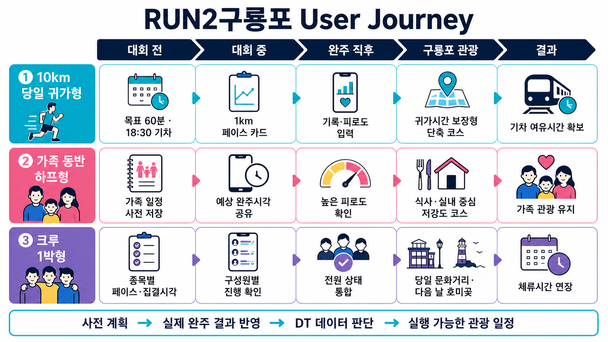
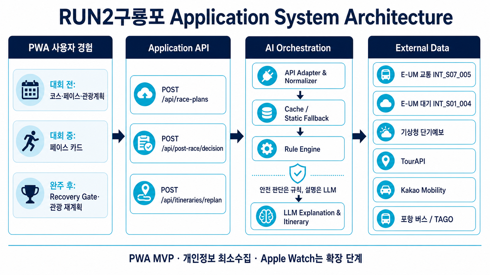
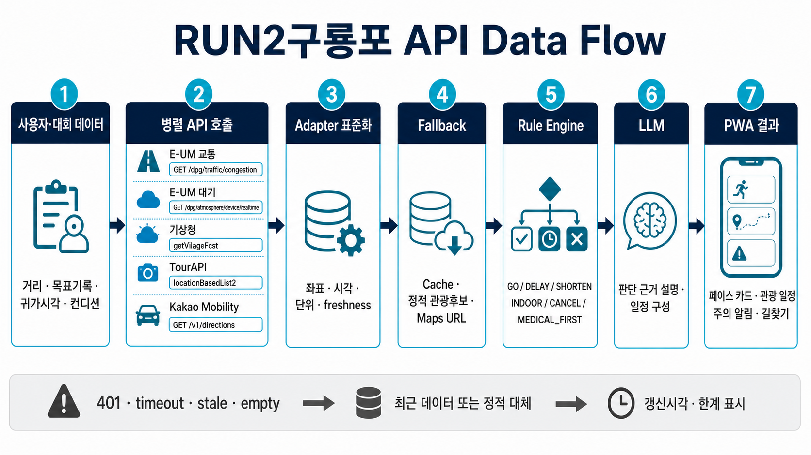

# RUN2구룡포 상세 기획서 초안

> **출발선부터 구룡포·호미곶까지 이어지는 AI 러닝 트윈**

| 문서 항목 | 내용 |
| --- | --- |
| 작성 목적 | 2026 디지털 트윈 구룡포 AI 해커톤 출품안 구체화 및 프로토타입 구현 기준 확정 |
| 제품 형태 | 설치 없이 QR·링크로 실행하는 PWA(모바일 웹) |
| 핵심 사용자 | 포항 외 지역에서 러닝 행사에 참가하고, 완주 뒤 2시간 이상 체류 가능성이 있는 러너·동반 가족·러닝크루 |
| 핵심 가치 | 대회 전 세운 러닝·관광 계획을 실제 완주 결과와 구룡포 데이터에 맞춰 다시 계산해, 실행 가능한 다음 행동 하나로 연결 |
| 문서 상태 | Draft v0.1 — 외부 API 키 기반 실응답 검증 전 |

---

## 0. Executive Summary

포항에는 러닝 행사와 구룡포·호미곶 남부 관광권이라는 두 자원이 있지만, 완주자가 피로한 상태에서 별도 이동을 결정해야 하는 공간적·인지적 단절이 있다. 관광지 목록만 제시해서는 “지금 출발해도 귀가 일정에 맞는가”, “내 컨디션으로 어느 정도 걸을 수 있는가”, “현재 날씨와 교통에서 어떤 코스가 가능한가”라는 질문에 답하기 어렵다.

**RUN2구룡포**는 대회 전부터 사용하는 러닝 플래너로 진입해 대회 중 페이스 카드를 제공하고, 피니시라인 이후에는 구룡포 관광 실행 Agent로 전환된다. 사용자의 목표·완주 시각·귀가 마감·자가 컨디션과 포항 E-UM 교통·대기환경, 기상청, TourAPI, 카카오모빌리티 데이터를 결합해 `바로 이동`, `회복 후 이동`, `코스 축소`, `실내 대안`, `관광 취소`, `의료 우선` 중 하나를 결정한다.

안전·시간 제약은 결정 규칙이 처리하고 LLM은 그 결과를 바꾸지 않은 채 이유를 설명하고 일정을 구성한다. MVP는 PWA로 구현하며 Apple Watch, 할인패스, 전용 셔틀, 공식 기록 자동 연동에 의존하지 않는다. 해커톤에서는 E-UM API를 최소 1개 이상 실제 호출해야 하므로 교통 `INT_S07_005`와 대기환경 `INT_S01_004`를 우선 연동한다.

---

## 1. 문제 정의와 기회

### 1.1 해결할 문제

러너의 하루는 대회 준비, 경기, 회복, 귀가로 이어지지만 기존 러닝 도구는 대체로 운동 종료와 함께 역할이 끝난다. 반대로 관광 정보는 완주자의 피로도, 귀가 마감, 이동수단, 남은 활동 가능 시간을 모른다. 이 단절 때문에 포항을 방문한 러너도 다음과 같은 불확실성을 스스로 해결해야 한다.

- 대회 장소에서 구룡포·호미곶까지 지금 얼마나 걸리는가?
- 식사와 관광을 하고도 기차·버스·자가용 귀가 일정에 맞출 수 있는가?
- 현재 기온·강수·대기 상태를 고려하면 실외 이동이 적절한가?
- 실제 기록이 계획보다 늦거나 피로도가 높을 때 어디까지 줄여야 하는가?
- 영업 중인 장소를 어떤 순서로 방문해야 불필요한 이동을 줄일 수 있는가?

문제는 관광지가 부족한 것이 아니라, **완주 이후의 불확실성을 하나의 실행 결정으로 바꾸는 연결 장치가 부족하다는 것**이다.

### 1.2 타 지역에서 얻는 시사점

- 경주벚꽃마라톤은 보문관광단지 일원에서 열려 코스와 관광권이 가깝고, 대회를 관광·숙박·외식 소비를 만드는 콘텐츠로 운영한다. 참가 번호표를 활용한 관광시설 혜택도 존재한다. ([경주시 공식 안내](https://www.gyeongju.go.kr/news/page.do?mnu_uid=1342&parm_bod_uid=310262&step=258), [참가자 특전](https://www.cherrymarathon.co.kr/gift/index03.php))
- 제주국제관광마라톤은 관광객 유치와 관광산업 활성화를 목적으로 관광업체의 홍보·협찬·할인쿠폰 참여를 사전에 모집한다. ([제주관광협회 공고](https://www.visitjeju.or.kr/visitjeju/comm/notice.htm?act=view&page=2&seq=58528))
- 포항은 이러한 혜택을 그대로 복제하기보다, 대회 장소와 구룡포·호미곶 사이의 이동 불확실성을 데이터로 낮추는 접근이 현실적이다. 확인되지 않은 할인·리워드·제휴는 제안 범위에서 제외한다.

### 1.3 제품 가설

> 러너가 대회 전에 구룡포 방문 의향과 귀가 제약을 저장하고, 완주 직후 실제 기록·컨디션·도시 데이터를 반영한 한 개의 실행 가능한 일정을 받으면, 단순 관광지 추천보다 구룡포 이동 시작률이 높아질 것이다.

검증은 다음 퍼널로 수행한다.

```text
대회 전 계획 저장
→ 완주 후 결과 재계산
→ 구룡포 일정 열람
→ 길찾기 실행
→ 구룡포 도착 확인(동의 기반)
→ 방문 장소 수·체류시간 집계
```

---

## 2. 서비스 정의

### 2.1 한 줄 정의

> 완주자의 상태·남은 시간과 구룡포의 교통·환경·관광 데이터를 함께 판단해, 러닝 계획을 피니시라인 이후의 실행 가능한 관광 일정으로 이어 주는 AI Agent.

### 2.2 핵심 원칙

1. **대회 전부터 유용해야 한다.** 관광을 위해 별도 앱을 설치시키지 않고 코스·페이스·준비 정보를 첫 가치로 제공한다.
2. **완주 직후 새 계획을 강요하지 않는다.** 사전에 저장한 계획을 실제 완주 결과에 맞춰 재계산한다.
3. **목록보다 결정을 제공한다.** 장소 열 개가 아니라 지금 가능한 다음 행동과 근거를 제시한다.
4. **안전 판단은 규칙, 설명은 LLM이 담당한다.** LLM이 의료 상태를 진단하거나 필수 중단 조건을 완화하지 못한다.
5. **데이터의 시각과 한계를 공개한다.** 관측 시각, 데이터 누락, 정적 대체 여부를 사용자에게 표시한다.
6. **웨어러블 없이 완주 가능해야 한다.** PWA MVP의 필수 입력은 사용자 입력과 공개 API만으로 충족한다.

### 2.3 MVP 범위

| 포함 | 제외·확장 |
| --- | --- |
| 대회·종목·목표 기록·귀가 시각 입력 | Apple Watch 실시간 심박·GPS 연동 |
| 목표 페이스와 구간별 페이스 카드 | 공식 기록 시스템 자동 연동 |
| 실제 완주 시각·피로도·위험 증상 입력 | 의료 진단·안전 보장 |
| E-UM 교통·대기환경 실제 호출 | 확인되지 않은 관광패스·할인·쿠폰 |
| 기상·관광·차량 경로 데이터 조합 | 전용 셔틀·좌석 예약 |
| 규칙 기반 결정과 LLM 설명 | 사업자 제휴가 전제되는 기능 |
| 지도 앱 길찾기 링크와 일정 재계산 | GPX가 없는 코스의 임의 고도 추정 |

---

## 3. User Journey



### 3.1 Journey A — 첫 10km 대회, 당일 귀가 개인

**상황:** 수도권 거주자, 목표 60분, 오후 18:30 기차, 대중교통 이용. 아래 시각은 제품 동작을 설명하기 위한 예시이며 실제 안내는 API 응답으로 계산한다.

1. 대회 전날 거리·출발 시각·목표 기록·기차 시각을 입력한다. 서비스는 목표 6분/km, 5km 통과 30분, 예상 완주 60분의 페이스 카드를 만든다.
2. `완주 후 구룡포·호미곶 방문`을 선택하면 귀가 마감에서 역산한 예비 관광 일정을 저장한다.
3. 경기 중에는 체크포인트별 목표 통과 시각과 예상 완주 시각만 짧게 확인한다.
4. 완주 후 실제 기록과 `피로 보통·통증 없음`을 입력한다. Agent는 현재 교통, 날씨, 운영 장소, 복귀 소요시간을 다시 조회한다.
5. 시간이 충분하면 단축형 코스와 `복귀 시작 마감`을 함께 보여 준다. 지연으로 여유시간이 기준 아래로 내려가면 장소를 줄이거나 관광을 취소한다.

**전환 장치:** 관광 욕구가 아니라 “기차를 놓치지 않는다는 시간 계획”이 이동 결정을 돕는다.

### 3.2 Journey B — 가족 동반 하프마라톤

**상황:** 하프 참가자, 배우자·자녀 동행, 자가용 이용, 긴 보행보다 가족 일정의 지속이 중요하다.

1. 대회 전 가족과 `구룡포 문화관광 후 호미곶`을 저장하고 예상 완주 시각을 공유한다.
2. 완주가 계획보다 늦고 러너가 높은 피로도를 입력하면 장거리 해안 보행을 제거한다.
3. 기온·강수·대기환경과 시설 정보를 반영해 식사·휴식·실내 문화시설 중심으로 먼저 구성한다.
4. 회복되지 않거나 시간이 부족하면 호미곶을 생략한다. 조건이 양호할 때만 차량 이동과 짧은 관람을 추가한다.

**전환 장치:** 러너의 피로 때문에 가족 전체가 바로 귀가하는 상황을, 낮은 활동 강도의 공동 일정으로 전환한다.

### 3.3 Journey C — 크루 1박형

**상황:** 10km·하프 참가자가 섞인 타 지역 크루, 대회 전날 도착해 다음 날 귀가한다.

1. 구성원별 종목·목표 기록을 입력하고 가장 늦은 예상 완주 시각을 기준으로 집결 계획을 만든다.
2. 전원 완주 뒤 실제 기록과 상태를 통합한다. 한 명이라도 위험 증상을 입력하면 그 사용자의 관광 일정 생성을 중단하고 의료 지원을 안내한다.
3. 전원이 이동 가능한 경우 당일 구룡포 식사·짧은 문화관광을 제안한다.
4. 다음 날 기상 상태를 다시 조회해 호미곶 방문안을 유지·축소·실내 대체한다.

**전환 장치:** 서로 다른 완주시간과 상태를 하나의 집결 시각과 공유 가능한 일정으로 정리해 크루 해산을 줄인다.

---

## 4. 기능 및 화면 요구사항

### 4.1 대회 전 — Race Planner

**입력**

- 대회명, 종목 거리, 출발 시각
- 목표 기록 또는 목표 페이스
- 귀가 마감 시각과 귀가 목적지
- 이동수단: 자가용 / 대중교통 / 동반자 차량
- 동반자 유형과 관광 선호

**처리**

- `목표 페이스 = 목표 기록 ÷ 거리`로 계산한다.
- 코스·급수 지점·출발 시각은 공식 자료를 관리자 데이터로 등록하고 출처와 갱신일을 함께 저장한다.
- 기상청 예보를 대회 시간대에 맞춰 요약한다.
- 예상 완주와 귀가 마감 사이에 관광 가능 시간이 있는지 예비 계산한다.

**출력 화면**

- 구간별 목표 페이스와 체크포인트 예상 시각
- 대회 준비 체크리스트와 날씨 주의 정보
- 완주 후 관광 의향 저장 카드
- “예상값이며 공식 기록이 아님” 표기

### 4.2 대회 중 — Pace Card

- 1km 또는 공식 체크포인트 단위 목표 누적 시각
- 사용자가 현재 지점을 선택하면 예상 완주 시각 재계산
- 작은 화면에서 한눈에 볼 수 있는 고대비 카드
- MVP에서는 백그라운드 GPS·웨어러블 데이터에 의존하지 않는다.

### 4.3 완주 직후 — Recovery Gate

**입력**

- 실제 완주 시각 또는 실제 기록
- 상태: 양호 / 많이 지침 / 통증 있음 / 어지럽거나 메스꺼움
- 관광 의향 유지 여부와 귀가 시각 변경 여부

**필수 동작**

- 어지럼증·메스꺼움, 심한 통증처럼 사용자가 위험 증상을 선택하면 `MEDICAL_FIRST`를 반환하고 관광 일정을 만들지 않는다.
- 그 외에는 회복 시간, 관광 활동 강도, 이용 가능한 시간 창을 계산한다.
- 서비스가 의료 진단이 아니며 응급 상황에서는 현장 의료진·119 안내를 우선한다는 문구를 고정 표시한다.

### 4.4 완주 후·관광 중 — Trip Copilot

- 한 번에 하나의 권장안과 최대 두 개의 대안을 보여 준다.
- 장소별 운영 여부, 예상 체류시간, 이동 순서, 복귀 시작 마감을 표시한다.
- 자가용은 Kakao Mobility 경로 요약을, 실패 시 Google Maps URL을 제공한다.
- 대중교통은 포항시 노선정보를 안내용으로 제공하고, TAGO 실응답 검증 전에는 실시간 도착으로 표현하지 않는다.
- 날씨·교통·운영정보가 바뀌면 `일정 다시 계산`을 실행한다.

---

## 5. AI 의사결정 설계

### 5.1 역할 분리

| 구성요소 | 담당 | 하지 않는 일 |
| --- | --- | --- |
| Rule Engine | 위험 증상 중단, 시간 예산, 활동 강도 상한, 실내·실외 가능성, 상태 코드 결정 | 자연어 설득, 임의의 장소 추천 |
| LLM | 확정된 상태 코드와 허용 장소 안에서 일정 구성, 근거 설명, 자연어 질의 응답 | `MEDICAL_FIRST` 해제, 데이터 누락 은폐, 의료 진단 |
| API Adapter | 응답 형식·시각·좌표·단위·신선도 표준화 | 안전 기준 결정 |

### 5.2 시간 예산 모델

```text
availableWindow = returnDeadline - currentTime
requiredWindow  = recoveryBuffer
                + outboundETA
                + visitDuration
                + returnETA
                + safetyBuffer
slack           = availableWindow - requiredWindow
```

- `slack < 0`이면 장소 수 또는 체류시간을 줄여 `SHORTEN`을 재계산한다.
- 최단 코스로도 `slack < 0`이면 `CANCEL`을 반환한다.
- 임계시간은 대회·교통수단별 운영 설정으로 관리하며 근거 없는 고정값을 문서에 단정하지 않는다.

### 5.3 결정 상태

| 상태 | 발생 조건 | 사용자 출력 |
| --- | --- | --- |
| `GO` | 위험 증상 없음, 시간 예산 충족, 사용 가능한 장소 존재 | 지금 출발과 권장 일정 |
| `DELAY` | 관광은 가능하지만 회복 또는 특정 시간대 출발이 유리 | 회복 후 권장 출발 시각 |
| `SHORTEN` | 전체 일정은 불가능하지만 최소 코스는 가능 | 장소·보행량을 줄인 일정 |
| `INDOOR` | 강수·환경 상태 또는 피로 때문에 야외 비중 축소 필요 | 식사·실내 중심 일정 |
| `CANCEL` | 귀가 마감까지 최소 일정 불가 또는 데이터로 실행 가능성 확보 불가 | 관광 보류와 귀가 안내 |
| `MEDICAL_FIRST` | 사용자가 위험 증상 선택 | 관광 생성 중단, 현장 의료지원 우선 안내 |

### 5.4 LLM 입력·출력 경계

LLM에는 원본 건강·위치 이력이 아니라 다음과 같은 파생 상태만 제공한다.

```json
{
  "decision": "SHORTEN",
  "reasonCodes": ["LOW_TIME_SLACK", "HIGH_SELF_REPORTED_FATIGUE"],
  "allowedPlaceIds": ["place_101", "place_204"],
  "maxWalkingMinutes": 30,
  "returnDeadline": "2026-10-13T17:20:00+09:00",
  "dataFreshness": {
    "traffic": "2026-10-13T11:00:00+09:00",
    "weather": "2026-10-13T10:30:00+09:00"
  }
}
```

LLM 출력은 구조화된 JSON으로 검증한 후 화면 문구로 변환한다.

```json
{
  "headline": "식사와 실내 관람 중심의 짧은 코스를 추천합니다.",
  "explanation": ["귀가까지 남은 시간", "입력한 피로도", "현재 환경 정보"],
  "stopOrder": ["place_101", "place_204"],
  "limitations": ["운영시간은 방문 전 다시 확인하세요."]
}
```

---

## 6. Application System Architecture



### 6.1 구성요소

1. **PWA Client**: 대회 전 입력, 페이스 카드, 완주 후 컨디션 확인, 관광 일정, 길찾기 링크를 제공한다.
2. **Application API**: 사용자 세션과 요청 검증, 인증, 속도 제한, 응답 캐시를 담당한다.
3. **API Orchestration Layer**: 서비스별 Adapter를 병렬 호출하고 공통 스키마로 표준화한다.
4. **Rule Engine**: 위험 증상, 시간 예산, 활동 강도, 데이터 가용성을 기준으로 상태 코드를 확정한다.
5. **LLM Layer**: 허용된 컨텍스트 안에서 일정과 설명을 생성한다. 프롬프트에는 데이터 시각과 제약을 포함한다.
6. **Data Store**: 최소 사용자 계획, 관리자 대회 데이터, 정적 관광 후보, API 캐시, 익명 이벤트를 저장한다.
7. **External Data**: E-UM, 기상청, TourAPI, Kakao Mobility, 포항시 버스, 조건부 TAGO를 Adapter 뒤에서 사용한다.

### 6.2 핵심 데이터 모델

| 엔터티 | 주요 필드 | 보존 원칙 |
| --- | --- | --- |
| `RacePlan` | 종목, 목표기록, 출발시각, 귀가마감, 이동수단 | 행사 종료 후 삭제 가능한 최소 계획 |
| `FinishCheck` | 실제기록, 자가 피로도, 위험증상 여부 | 원문 대신 상태 코드 중심 저장 |
| `EnvironmentSnapshot` | 출처, 관측·예보시각, 값, freshness, fallback 여부 | 재현과 설명을 위한 단기 캐시 |
| `Itinerary` | 결정상태, 장소순서, ETA, 복귀마감, 설명 | 사용자 요청으로 삭제 가능 |
| `ConversionEvent` | 계획열람, 길찾기실행, 도착확인 | 개인 식별자를 제거한 집계용 이벤트 |

---

## 7. 외부 데이터와 API

### 7.1 API 포트폴리오

| 우선순위 | 서비스 | 호출·주요 필드 | 사용 목적 | 검증 상태 |
| --- | --- | --- | --- | --- |
| 필수·실호출 | E-UM 교통 `INT_S07_005` | `GET https://genix.pohang-eum.kr/dpg/traffic/congestion?serviceKey={KEY}` → `hour`, `cntPerc` | 시간대별 혼잡 신호와 출발시각 조정 | 키 발급 후 실응답 확인 필요 |
| 필수·실호출 | E-UM 대기환경 `INT_S01_004` | `GET https://genix.pohang-eum.kr/dpg/atmosphere/device/realtime?serviceKey={KEY}&id={deviceId}` → `logDateTime`, `pm10`, `pm25`, `temp`, `humi`, `winsp`, `windir` | 환경정보 표시와 실내·실외 일정 보조 | 키 발급 후 실응답 확인 필요 |
| 핵심 | 기상청 단기예보 | `getVilageFcst`, `getUltraSrtFcst`, `getUltraSrtNcst` → `TMP/T1H`, `REH`, `WSD`, `RN1`, `PTY`, `SKY` | 대회·관광 시간대 기상 판단 | 공식 스키마 확인, 키 실응답 대기 |
| 핵심 | TourAPI 국문관광정보 | `locationBasedList2`, `detailCommon2`, `detailIntro2`, `detailImage2`, `searchKeyword2`, `searchFestival2` | 위치 기반 관광 후보, 소개·이미지·운영정보·행사 | 공식 스키마 확인, 키 실응답 대기 |
| 핵심 | Kakao Mobility 길찾기 | `GET /v1/directions`, `GET /v1/future/directions` → route summary의 거리·소요시간 | 자가용 현재·예정 출발 ETA | REST 키 실응답 대기 |
| 보조·무키 | Google Maps URL | `https://www.google.com/maps/dir/?api=1&origin=...&destination=...` | 경로 API 실패 시 사용자 길찾기 실행 | 키 불필요 |
| 보조 | 포항시 시내버스 노선정보 | 노선명, 기·종점, 정류장, 운행시간 등 정적 정보 | 대중교통 노선 안내 | 연간 갱신 데이터, 실시간으로 표기 금지 |
| 검증 후 | TAGO 버스도착정보 | `getSttnAcctoArvlPrearngeInfoList`, `nodeId` | 정류소 기준 버스 도착예정 | 포항 도시코드·대상 노선 응답 확인 전 후보 |
| 확장 | E-UM 자외선 `INT_S06_005` | `GET /dpg/sensor/latest/uvIndex` → `dateTime`, `uvIndex` | 야외 체류시간 보조 | MVP 비핵심 |
| 조건부 | E-UM 수위 `INT_S05_006` | `GET /dpg/sensor/latest/sensorLevel` → 위치·값·등급 | 해안 동선의 보조 위험 신호 | 센서 범위 확인 후 사용 |
| 조건부 | E-UM 방파제 `INT_S06_006` | `GET /dpg/aicctv/avghour/datas` → 시간대별 넘어짐·침입·접근 건수 | 방파제 이상행동 통계 참고 | 관광객 혼잡도로 해석 금지 |
| 확장 | HealthKit·WorkoutKit | `HKWorkoutSession`, `PacerWorkout` 등 | 네이티브 iOS/Watch 운동 데이터 | PWA MVP에서 제외 |

**근거 링크:** [E-UM API 자료실](https://pohang-eum.kr/data), [기상청 단기예보](https://www.data.go.kr/data/15084084/openapi.do), [TourAPI](https://www.data.go.kr/tcs/dss/selectApiDataDetailView.do?publicDataPk=15101578), [Kakao Mobility 길찾기](https://developers.kakaomobility.com/guide/navi-api/start), [Google Maps URL](https://developers.google.com/maps/documentation/urls/get-started), [포항시 버스노선](https://www.data.go.kr/data/3034960/fileData.do), [TAGO 버스도착](https://www.data.go.kr/data/15098530/openapi.do), [HealthKit](https://developer.apple.com/documentation/healthkit/running-workout-sessions), [WorkoutKit](https://developer.apple.com/documentation/workoutkit).

### 7.2 E-UM 행사 정보의 경계

[E-UM 종합플랫폼](https://total.pohang-eum.kr/platform/monitor)에 행사·관광 정보가 노출되더라도 안정적인 공개 API 엔드포인트와 응답 계약이 확인되기 전에는 실연동으로 주장하지 않는다. 행사 실데이터는 TourAPI `searchFestival2`를 우선 사용하고, E-UM 화면 정보는 운영자 확인용 참고로만 둔다.

### 7.3 API가 아닌 관리자·정적 데이터

- **대회 코스·출발시각·급수 지점:** 공식 운영자료를 관리자 화면에서 등록하고 출처 URL·갱신일을 기록한다.
- **코스 고도:** 공식 GPX가 제공될 때만 계산한다.
- **완주 기록:** 공식 기록 시스템 계약 전까지 사용자가 직접 입력한다.
- **관광 대체 목록:** TourAPI가 비어 있거나 운영시간 신뢰도가 낮을 때 사용할 구룡포·호미곶 후보 5~10개를 검증해 저장한다.
- **복귀 교통:** 사용자가 입력한 열차·버스 출발 시각을 기준으로 계산하며 예약이나 좌석 보장은 하지 않는다.

---

## 8. API Data Flow



### 8.1 호출 순서

1. PWA가 거리·목표기록·귀가시각·자가 컨디션과 관리자 대회 ID를 Application API로 전송한다.
2. Orchestrator가 E-UM 교통·대기환경, 기상청, TourAPI, Kakao Mobility를 시간 제한 안에서 병렬 호출한다.
3. Adapter가 좌표계, 날짜·시각, 단위, 관측·예보 기준시각, 데이터 신선도를 공통 스키마로 정규화한다.
4. 오류·빈 응답·오래된 데이터에는 캐시 또는 정적 대체 데이터를 적용하고 `fallbackUsed`와 한계를 기록한다.
5. Rule Engine이 시간 예산과 Recovery Gate를 실행해 변경할 수 없는 상태 코드를 만든다.
6. LLM은 상태 코드, 허용 장소, 제한조건을 입력받아 설명과 일정을 구성한다.
7. API는 페이스 카드, 관광 일정, 주의 알림, 지도 URL, 출처별 갱신시각을 PWA에 반환한다.

### 8.2 공통 외부 데이터 형식

```json
{
  "source": "POHANG_EUM_TRAFFIC",
  "observedAt": "2026-10-13T11:00:00+09:00",
  "fetchedAt": "2026-10-13T11:03:10+09:00",
  "freshness": "FRESH",
  "fallbackUsed": false,
  "values": {
    "hour": 11,
    "congestionPercent": 42
  }
}
```

### 8.3 장애·대체 정책

| 상황 | 서버 동작 | 사용자 표시 |
| --- | --- | --- |
| 키 누락·401 | 해당 Adapter 비활성화, 허용된 캐시 확인 | “교통 데이터 연결 대기”와 갱신시각 |
| timeout·5xx | 짧은 재시도 후 최근 캐시 사용 | “최근 확인 데이터 사용” |
| 빈 관광 결과 | 검증된 정적 후보 목록으로 대체 | “운영시간은 방문 전 확인” |
| 오래된 관측값 | `STALE`로 표시하고 의사결정 가중치 축소 | 데이터 기준시각 명시 |
| Kakao 경로 실패 | 정적 이동 버퍼와 Google Maps URL 제공 | 예상시간의 한계와 길찾기 버튼 |
| TAGO 포항 미지원 | 실시간 도착 기능 숨김 | 정적 노선 안내만 제공 |
| LLM 오류·스키마 불일치 | 결정 상태는 유지하고 템플릿 설명 반환 | 기능 중단 없이 기본 설명 표시 |

---

## 9. 내부 Application API

### 9.1 `POST /api/race-plans`

```json
{
  "raceId": "pohang-race-demo",
  "distanceKm": 10,
  "targetDurationMinutes": 60,
  "startAt": "2026-10-13T08:00:00+09:00",
  "returnDeadline": "2026-10-13T17:20:00+09:00",
  "transportMode": "PUBLIC_TRANSIT",
  "postRaceIntent": "GURYONGPO_HOMIGOT"
}
```

응답에는 `targetPaceSecPerKm`, 체크포인트별 `targetElapsedSec`, 예상 완주시각, 대회 날씨 요약, 예비 관광 가능성, 데이터 출처·시각을 포함한다.

### 9.2 `POST /api/post-race/decision`

```json
{
  "racePlanId": "rp_123",
  "finishDurationMinutes": 64,
  "selfReportedState": "TIRED",
  "dangerSymptoms": [],
  "returnDeadline": "2026-10-13T17:20:00+09:00"
}
```

응답은 `decision`, `reasonCodes`, `recommendedDepartureAt`, `returnStartBy`, `dataFreshness`, `itinerary`를 반환한다. `dangerSymptoms`가 비어 있지 않으면 `MEDICAL_FIRST`와 고정 안전문구만 반환한다.

### 9.3 `POST /api/itineraries/replan`

```json
{
  "itineraryId": "it_456",
  "currentAt": "2026-10-13T14:10:00+09:00",
  "currentPlaceId": "place_101",
  "returnDeadline": "2026-10-13T17:20:00+09:00",
  "changeReason": "USER_REQUEST"
}
```

응답은 기존 결정을 유지하거나 `SHORTEN`, `INDOOR`, `CANCEL`로 전환한 새 장소 순서와 복귀 마감을 반환한다.

---

## 10. 개인정보·안전·API 키

- 상세 위치는 기능 수행 중에만 사용하고, KPI에는 격자·시간대 단위의 익명 이벤트만 남긴다.
- 자가 컨디션 원문과 불필요한 건강·GPS 이력은 장기 저장하지 않는다.
- 외부 API 키는 서버 환경변수 또는 Secret Manager에만 저장하고 PWA 번들, Markdown, 로그, Git에 포함하지 않는다.
- E-UM 기존 계정에서 `INT_S07_005`, `INT_S01_004` 이용 신청 시 활용 분야는 `관광`, 목적은 `학술/연구`로 기재한다.
- 로그인, CAPTCHA, OTP는 계정 소유자가 직접 처리한다.
- 의학적 진단, 관광 안전 보장, 귀가편 탑승 보장을 표현하지 않는다.

---

## 11. 구현 계획

### 1주차 — 데이터 계약과 핵심 플로우

- 관리자 대회 데이터와 `RacePlan` 스키마 확정
- 목표 페이스·체크포인트 계산 및 PWA 입력 화면
- E-UM 교통·대기환경 Adapter와 키 없는 상태의 오류 처리
- 기상청·TourAPI·Kakao Adapter 인터페이스와 mock 응답

### 2주차 — 결정·설명·관광 일정

- Recovery Gate와 시간 예산 Rule Engine
- 관광 후보 필터·순서화 및 정적 대체 목록
- LLM 구조화 출력, 금지 규칙, 템플릿 fallback
- 완주 후 판단 화면과 지도 URL 연결

### 3주차 — 재계획·데모·검증

- `POST /api/itineraries/replan`과 데이터 갱신
- 3개 사용자 여정 데모 시드
- 오류·빈 응답·stale·401·timeout 시나리오 테스트
- 출처·갱신시각·비의료 문구, 모바일 접근성, 발표 시연 점검

---

## 12. 검증 계획과 완료 기준

### 12.1 API·계약 테스트

- E-UM 교통 API가 HTTP 200과 `hour`, `cntPerc`를 반환한다.
- E-UM 대기 API가 HTTP 200과 `logDateTime`, `pm10`, `pm25`, `temp`, `humi`, `winsp`, `windir` 중 실제 제공 필드를 반환한다.
- `serviceKey` 누락·오류 시 401을 처리하고 비밀값을 로그에 출력하지 않는다.
- 기상청·TourAPI·Kakao는 공식 스키마와 실제 키 응답을 비교해 Adapter 계약을 고정한다.
- TAGO는 포항 도시코드와 목표 정류소 응답이 확인된 후에만 실시간 기능을 켠다.

### 12.2 결정 테스트

1. 정상 컨디션·시간 충분 → `GO`
2. 피로 높음·시간 충분 → `DELAY` 또는 `SHORTEN`
3. 야외 조건 불리·실내 후보 존재 → `INDOOR`
4. 귀가 여유 부족 → `CANCEL`
5. 위험 증상 입력 → 항상 `MEDICAL_FIRST`, LLM 관광 생성 없음
6. 외부 데이터 일부 장애 → 캐시·정적 대체와 한계 표시
7. 웨어러블 없음 → 대회 전부터 관광까지 전체 여정 완료

### 12.3 문서·데모 완료 기준

- 최소 1개 E-UM API의 실제 호출 화면 또는 응답 시각화가 데모에 포함된다.
- LLM이 단순 Q&A가 아니라 판단 근거, 추천, 변경 알림, 일정 시각화를 제공한다.
- 3개 사용자 여정이 동일한 내부 API와 상태 코드로 동작한다.
- 이미지 속 API명과 본문 명세가 일치하고, 이미지 대체 텍스트가 제공된다.
- 제출 초안의 기능·API·범위가 본 상세본과 모순되지 않는다.

---

## 13. 성과지표와 지역 활용

| 단계 | KPI | 의미 |
| --- | --- | --- |
| 획득 | 대회 전 계획 생성률 | 러닝 도우미로 초기 가치를 제공했는지 |
| 의향 | 구룡포 관광 사전 저장률 | 완주 전 방문 의향 형성 여부 |
| 판단 | 완주 후 재계산 완료율 | 피니시라인 이후 서비스 지속성 |
| 행동 | 길찾기 실행률 | 추천이 실제 이동 행동으로 이어졌는지 |
| 방문 | 동의 기반 구룡포 도착 확인율 | 방문 전환 성과 |
| 체류 | 평균 방문 장소 수·체류시간 | 남부 관광권 체류 확대 가능성 |
| 운영 | 상태별 취소·축소·실내 전환율 | 데이터 기반 재계획이 실제 작동했는지 |

익명화된 집계는 행사별 예상 방문 수요, 시간대별 이동 시도, 자가용·대중교통 비율, 관광 취소 이유를 보여 줄 수 있다. 이는 향후 포항시가 러닝 행사와 구룡포 관광을 연결하는 교통·운영 정책을 설계할 때 근거 데이터로 활용할 수 있다. 다만 MVP에서 실제 매출·숙박·상점 소비를 측정한다고 주장하지 않는다.

---

## 14. 핵심 메시지

> **RUN2구룡포는 관광지를 나열하는 앱이 아니다.** 대회 전부터 러너의 하루를 계획하고, 실제 완주 결과와 구룡포 디지털 트윈을 결합해 “지금 무엇을 할 수 있는가”를 판단함으로써 피니시라인 이후의 이동을 만드는 스포츠 관광 AI Agent다.

## 15. 참고자료

- 2026 디지털 트윈 구룡포 AI 해커톤 안내(주최 측 제공 자료)
- [E-UM 디지털트윈 포항 API 자료실](https://pohang-eum.kr/data)
- [E-UM 구룡포 종합플랫폼](https://total.pohang-eum.kr/platform/monitor)
- [기상청 단기예보 조회서비스](https://www.data.go.kr/data/15084084/openapi.do)
- [한국관광공사 국문 관광정보 서비스](https://www.data.go.kr/tcs/dss/selectApiDataDetailView.do?publicDataPk=15101578)
- [Kakao Mobility 길찾기 API](https://developers.kakaomobility.com/guide/navi-api/start)
- [Google Maps URL](https://developers.google.com/maps/documentation/urls/get-started)
- [포항시 시내버스 노선정보](https://www.data.go.kr/data/3034960/fileData.do)
- [TAGO 버스도착정보](https://www.data.go.kr/data/15098530/openapi.do)
