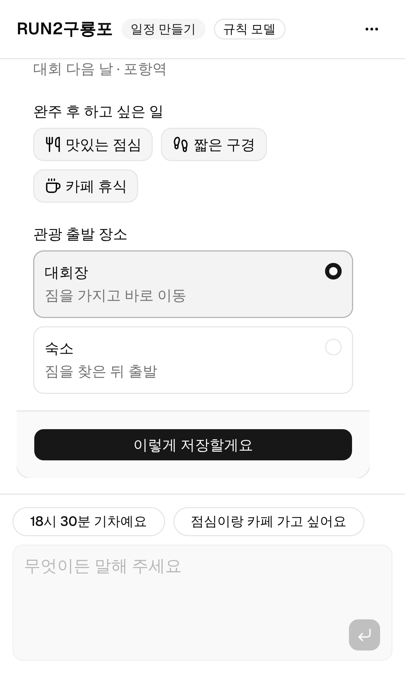
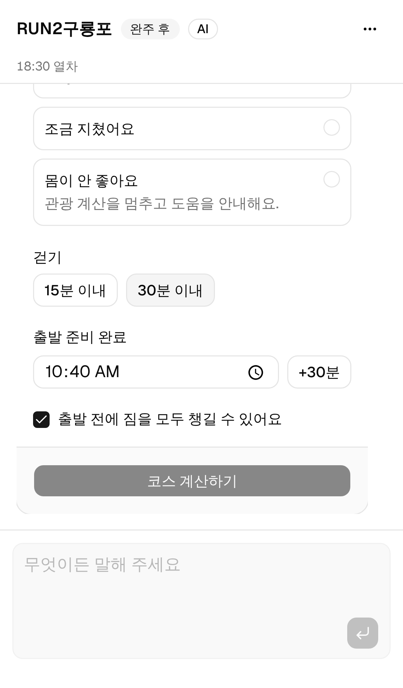
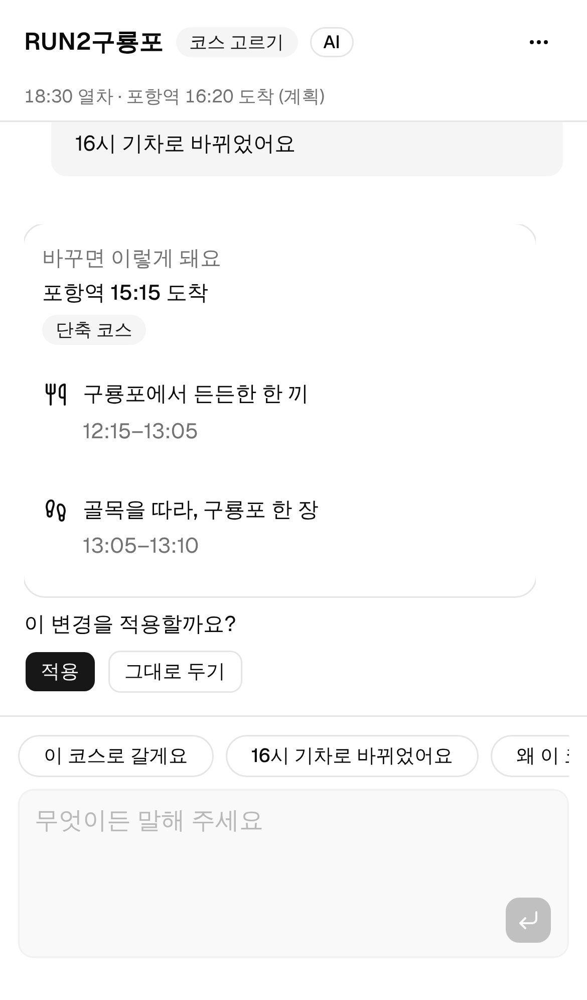
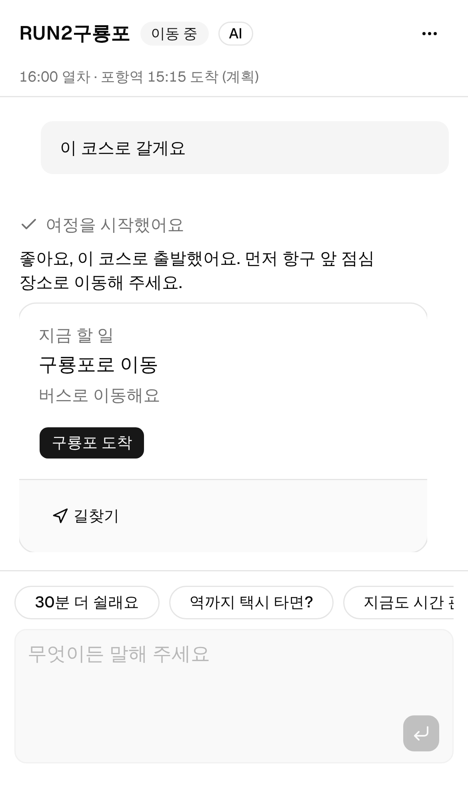
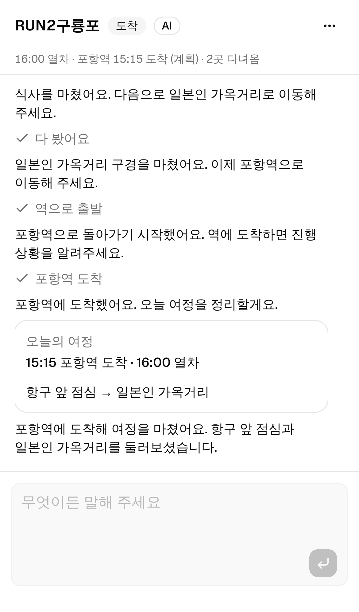

# RUN2구룡포 web — TanStack Start · shadcn · Vercel AI SDK · PWA

포항 러닝 대회를 마친 러너가 완주 후 포항을 둘러보고(구룡포·호미곶·영일대·죽도시장) 기차·버스·비행기·자가용 시간 또는 귀가 시각까지 돌아오도록 돕는 모바일 PWA입니다. 기획·명세는 [`docs/`](../docs)를, 이전 Vite+Express 데모는 저장소 루트를 참고하세요.

## 화면 (iPhone 13 기준, 실제 모델로 진행)

처음 한 번 **프로필**(귀가 방법·시각·가고 싶은 곳(기본 구룡포)·하고 싶은 일·출발 장소)을 받고, 그다음은 **홈(대회 개요) · 레이스 · 관광 · 커뮤니티** 탭과 우측 하단 **에이전트 시트**로 움직입니다. 프로필은 채팅과 같은 `slots.filled` 이벤트로 기록되어 에이전트가 다시 묻지 않습니다. 관광 탭과 채팅은 같은 서버 여정(`TripView`)을 읽어 항상 같은 코스를 보여줍니다. 아래는 이전(채팅 단독) 화면 설명입니다.

앱 전체가 하나의 대화입니다. 폼이 없습니다. 돌아가는 방법(기차·버스·비행기·자가용·포항 주민)·출발 시각·가고 싶은 코스(또는 추천)·하고 싶은 일·출발 장소·완주 후 상태를 앱이 한 번에 하나씩 묻고, 사용자는 말로 답하거나 답 버튼을 누릅니다(버튼은 그 문장을 대신 보내 줄 뿐입니다). 코스·변경 승인·다음 행동만 대화 안의 카드로 뜹니다.

| 일정 만들기                           | 완주 후                                 | 변경 승인                                 | 이동 중                                 | 도착                                  |
| ------------------------------------- | --------------------------------------- | ----------------------------------------- | --------------------------------------- | ------------------------------------- |
|  |  |  |  |  |

화면 단위 UI는 `/classic`에 남겨 두었고, 같은 서버 여정을 읽고 씁니다: [하루 만들기](docs/screenshots/1-내하루만들기.png) · [데모 시나리오](docs/screenshots/2-데모컨트롤.png) · [코스](docs/screenshots/3-구룡포코스.png) · [다음 행동](docs/screenshots/6-다음행동.png).

## 실행

Node.js 22.12 이상이 필요합니다.

```sh
cd web
npm install
cp .env.example .env   # 키가 없어도 시연 모드로 동작
npm run dev            # http://localhost:3000
npm run check          # 타입 검사 + 테스트(vitest)
npm run build && npm start   # 프로덕션(Nitro node 서버)
```

휴대폰으로 확인하려면 같은 네트워크에서 `http://<PC IP>:3000`을 엽니다. 홈 화면 설치·오프라인(서비스 워커)은 HTTPS 배포에서 동작합니다.

## 기술 스택

| 영역       | 선택                                                                                                                                                           |
| ---------- | -------------------------------------------------------------------------------------------------------------------------------------------------------------- |
| 프레임워크 | TanStack Start (Vite, file routes, server routes·server functions) + Nitro                                                                                     |
| UI         | shadcn/ui Nova 구조(radix, Geist)를 유지하며 앱 CSS 토큰에 바다색 브랜드 테마 적용. 공용 컴포넌트 원본은 유지하고 지역 사진·자체 갈매기 캐릭터를 화면에서 조합 |
| Agent      | Vercel AI SDK v7 `ToolLoopAgent` + 단계별 도구(계획·지식 조회·실시간 공공데이터) → `useChat` + AI Elements(Conversation·Message·PromptInput·Tool·Suggestion)   |
| 모델       | `@ai-sdk/openai`, 기본 `gpt-6-luna`(설정값). `OPENAI_MODEL`로 덮어씀                                                                                           |
| 저장소     | Drizzle ORM + PostgreSQL(`DATABASE_URL`) 또는 PGlite(내장 Postgres/WASM)                                                                                       |
| PWA        | `manifest.webmanifest` + 규칙 테이블 기반 서비스 워커(`public/sw.js`)                                                                                          |

## 설계 원칙

**함수형 코어, 얇은 껍데기.** `src/core/`는 IO가 없는 순수 함수만 둡니다. 서버(`src/server/`)와 화면(`src/app/`)은 코어를 조합할 뿐입니다.

- **AI 추천 = 모델 선택 + 코드 검증** (`core/agent-plan.ts`, `server/agent/tools.ts`). OpenAI가 E-UM 관측·사용자 요청·장소와 구간 자료를 읽고 장소, 순서, 체류시간, 구간별 이동수단, 혼잡 여유를 구조화된 제안으로 제출합니다. 코드는 경로, 시간 범위, 도착 목표, 총 보행량을 검증하며 실패 이유를 돌려줘 모델이 수정합니다. 검증된 선택과 근거는 `plan.agentPlan`에 저장되고 채팅·관광 탭·진행 버튼 모두 같은 계산 결과를 사용합니다. 관측 갱신은 재검토 표시를 남기며 임의로 다른 코스를 선택하지 않습니다.
- **시연·장애 대체 엔진 = 규칙의 합성** (`core/planner.ts`). `decideWith([medicalFirst, incomplete, atStation, routeUnavailable, returnLeg], courseSearch)` — 앞의 규칙이 답하면 끝나고, 아니면 다음으로 넘깁니다(SICP의 데이터 지향 디스패치). 우선순위는 코드 순서 그 자체입니다.
- **시연·장애 대체 모드의 관측 신호 = 모노이드** (`core/signals.ts`). 각 신호 종류는 해석기를 하나씩 갖고, 결과(여유 시간·야외 제한·불확실성·이유)는 `max`/`or`/`concat`으로 접힙니다. 자외선 같은 새 신호는 설정에 항목을 추가하면 됩니다(테스트: `새 관측 신호(자외선)를 설정에 추가하면 야외 장소가 빠짐`).
- **상태 = 이벤트의 왼쪽 접기** (`core/trip.ts`). `state = events.reduce(apply, initial)`. 화면은 명령(`state → events`)만 실행하고, 이벤트는 그대로 jsonb로 서버에 기록됩니다. 계획 변경만 `revision`을 올려, 늦게 도착한 Agent 미리보기는 `applyPreview`가 거절합니다.
- **도구 = 클로저** (`server/agent/tools.ts`). 요청 하나의 계획·관측·예산을 닫아 넣은 함수(`makeOps`)를 만들고, AI SDK 도구(`makeTools`)는 그 위에 스키마만 씌웁니다. 모델이 고르든 결정적 해석기가 고르든 같은 함수가 실행됩니다.

**설정은 데이터(jsonb).** 대회 정보(`event`), 코스(`courses` — 권역별 이동시간·귀가 거점별 복귀시간·단축 단계), 귀가 방법(`modes` — 거점·여유 시간·질문 문구), 장소(`places`), 안내 자료(`guide`), 관측 소스 계약, Agent 한도, 시연 시나리오가 전부 `core/seed/*`·`core/defaults.ts`의 시드 → DB(jsonb) 문서입니다. 코드 수정 없이 DB 수정으로 동작이 바뀝니다. 시드 `version`이 오르면 손대지 않은 옛 시드 행은 새 시드로 교체됩니다.

```sql
-- 기차 이용자의 역 도착 목표를 열차 20분 전으로: 다음 요청부터 반영(30초 캐시)
UPDATE app_config SET value = jsonb_set(value, '{0,bufferMin}', '20'), version = version + 1 WHERE key = 'modes';
-- 장소 추가/비활성화
UPDATE places SET active = false WHERE id = 'cafe';
-- 출발 시각을 바꾼 이벤트만 jsonb로 조회
SELECT payload #>> '{patch,departTime}' FROM trip_events WHERE payload -> 'patch' ? 'departTime';
```

설정 문서는 시드 위에 깊은 병합되고 `configSchema`로 검증됩니다. 잘못된 수정은 통째로 거부되고 시드로 대체되며, `/api/status`의 `configIssues`로 드러납니다.

| 테이블                  | 관계형 열                      | jsonb                                                                                                               |
| ----------------------- | ------------------------------ | ------------------------------------------------------------------------------------------------------------------- |
| `app_config`            | key, version                   | `value`(event·policy·courses·modes·guide·sources·agent·conversation·scenarios·anchors·defaults), `meta`             |
| `places`                | id, kind, sort, active         | `attrs`(이름·설명·좌표·야외 여부·아이콘…), `meta`(출처·검증 상태)                                                   |
| `trips`                 | id                             | `state`(최신 접힌 상태 — 서버가 단일 원천), `messages`(AI SDK UIMessage 대화), `meta`(적용한 카드 id·변경 미리보기) |
| `trip_events`           | trip_id, type, created_at      | `payload`(이벤트 본문), `meta` — append-only, GIN 인덱스                                                            |
| `observation_snapshots` | source_id, status, observed_at | `payload`(허용 필드만), `meta` — 실응답 스냅샷 재생용                                                               |

## Agent 흐름

설계: [`docs/agent-ux.md`](docs/agent-ux.md). 한 턴은 `src/server/agent/harness.ts`의 `runTurn` 하나입니다.

```
클라이언트 → 마지막 메시지 1개만 전송 (사용자 문장, 또는 카드 답·승인이 담긴 assistant 메시지)
서버      → 저장된 대화에 병합 (클라이언트는 새 문장과 열린 카드의 답·승인만 바꿀 수 있음)
          → 카드 답을 이벤트로 결정적 적용 (모델이 폼 값을 옮겨 적지 않음)
          → 안전 게이트: 증상 언급 → SAFETY, 모델 호출 0
          → ToolLoopAgent (prepareStep마다)
               · 단계(stage)별 activeTools — 질문 문장이면 커밋 도구 제외
               · 강제 도구 — 일정·완주 후 자유 입력 → update_trip_details, 계획 진입 → plan_course,
                 AI 계획 → get_planning_context → plan_course(proposal) → 검증·수정,
                 최초 유효 제안은 저장, 기존 일정 변경 → apply_plan_change(승인 카드)
               · 지시문 = 기본 원칙 + 단계 지시 + 여정 요약
               · toolApproval: 계획 변경은 항상 사용자 승인(HMAC 서명), "이 코스로 갈게요"는 자동 승인
          → 단계가 기다리는 카드가 없으면 하네스가 붙임 (await_progress 등)
          → data-trip(요약 바), 대화·meta 저장
```

**Ask**(`ask_quick_reply`, `await_progress`)는 `execute`가 없어 루프가 멈추고 카드가 뜹니다. **Read**(`get_planning_context`, `compare_courses`, `explain_plan`, `compare_transport`, `summarize_trip`, `show_safety_help`와 아래 지식·실시간 조회 도구)는 계획을 바꾸지 않습니다. `update_trip_details`, `record_race_progress`, `apply_plan_change`, `start_journey`, `set_demo_observation`은 이벤트를 남깁니다. `plan_course`도 최초 유효 AI 제안을 저장하며, 이후 제안은 승인 전까지 미리보기로 보관합니다. `check_live_conditions`는 관측 갱신 이벤트를 기록할 수 있습니다.

일정·완주 후 정보는 대화로 채웁니다([설계](docs/agent-ux.md#10-대화로-정보-받기)). 질문 순서·문구·답 버튼은 설정의 `conversation`(jsonb)에 있고, 다음 질문은 모델이 아니라 앱이 붙입니다. 답 버튼을 누르면 값이 함께 가서 모델 없이 저장되고, 자유롭게 쓴 문장은 모델이 `update_trip_details`로 읽어 저장합니다.

OpenAI가 연결되면 `plan_course`는 직접 작성한 proposal과 최신 contextRevision을 요구합니다. 기존 임계값의 야외 일괄 제외나 피로 기반 택시 우선 규칙은 AI 제안에 적용하지 않습니다. 출처·유효기간·관측 범위를 포함한 근거를 제공하고 의료 우선 처리는 유지합니다. 최초 제안은 검증 후 저장하며 이후의 변경은 기존 승인 절차를 거칩니다. 실패한 제안은 최대 세 번까지 검증하고 완성되지 않았음을 설명합니다. 추론과 구조화된 제안에 필요한 응답 예산은 최소 6,000토큰입니다.

키가 없거나 모델 호출이 실패하면 같은 하네스에서 규칙 기반 `LanguageModelV4`(`scripted-model.ts`)가 응답합니다. 도구·승인·카드·저장이 모두 같고 모델만 바뀝니다(헤더 배지: AI / 규칙 모델 / 규칙 모델(대체)).

**지식은 프롬프트가 아니라 도구에.** 지시문에는 원칙과 여정 요약만 있고, 대회·관광·교통 정보는 모델이 필요할 때 도구로 조회합니다. 결과에 없는 버스 번호·시간·요금은 말하지 않도록 지시합니다.

| 도구                              | 출처                                    | 답하는 질문                                            |
| --------------------------------- | --------------------------------------- | ------------------------------------------------------ |
| `get_race_info`                   | 설정 `event`                            | 대회 일시·장소, 대회 코스, 준비물, 시설, 규정, FAQ     |
| `search_guide`                    | 설정에서 만든 문서(`core/knowledge.ts`) | 코스·장소 설명과 팁, 포항 볼거리·먹거리·교통 요령·축제 |
| `compare_courses`                 | 결정 엔진                               | 지금 조건으로 모든 코스 비교                           |
| `find_nearby`, `get_place_detail` | 한국관광공사 TourAPI(KorService2)       | 주변 관광지·음식점·숙소, 영업시간·휴무                 |
| `get_directions`                  | 카카오맵 링크 + TAGO 정류장·도착        | 어떻게 가요, 버스 뭐 타요                              |
| `get_bus_arrivals`                | 국토교통부 TAGO 버스                    | 근처 정류장·지나는 노선·실시간 도착                    |
| `get_train_times`                 | 국토교통부 TAGO 열차                    | 포항 출발 열차 시간표                                  |
| `get_weather`                     | 기상청 단기예보                         | 시간대별 기온·강수·바람                                |

**규칙 기반 시연의 구룡포 우선.** 코스가 `auto`(추천)이면 `policy.featuredCourse`(구룡포)를 먼저 계산해 가능하면 고르고, 불가능할 때만 다른 코스 중 최선을 고르며 이유를 남깁니다. 같은 조건으로 갈 수 있는 다른 코스는 `itinerary.alternatives`로 내려가 관광 탭의 "다른 코스도 있어요" 칩이 됩니다.

**디지털 트윈 실측을 판단에.** 관측값마다 출처(`observations.sources`: LIVE · SNAPSHOT · DEMO · SIMULATED, 소스·관측·조회 시각)를 기록합니다. 판단 소스(`sources[].decision`: 교통 혼잡·자외선, 검증 설정을 켠 장비 8의 대기 시간 통계)는 LIVE·FRESH일 때 `observations.patched` 이벤트로 반영합니다. 저장된 AI 일정은 선택을 유지하고 근거가 바뀌면 재검토를 표시하며, 새 제안은 승인 후 적용합니다. 규칙 모델은 갱신된 관측으로 교통 여유와 야외 제한을 다시 계산합니다. 실패·오래된 응답이면 판단용 값을 비우고 확인 불가 사유와 기존 근거를 표시합니다. 단위 미검증 대기 실시간 값(INT_S01_004)은 근거 패널에만 둡니다. 반영 시점은 계획·이동 단계 턴 시작(5분 간격), `check_live_conditions`, 관광 탭 진입(`GET /api/trips/:id?live=1`)입니다. 시연 시나리오 값은 DEMO로 표시되고 실측이 덮어쓰지 않습니다.

공공데이터 도구는 `DATA_GO_KR_SERVICE_KEY`가 없거나 호출이 실패하면 `NOT_CONFIGURED`/`ERROR`를 돌려주고, 모델은 안내 자료와 길찾기 링크로 대신 답합니다.

시연 조건은 채팅에 `/시연 혼잡만 82%로`처럼 보내거나 헤더 메뉴 → 시연 조건에서 고릅니다.

## 음성 모드 (베타)

메뉴 → "음성 모드 (베타)"를 켜면 에이전트 시트 입력창에 마이크 버튼이 생깁니다. OpenAI Live(`gpt-live-1`, speech-to-speech)가 듣고 말하지만 **결정은 하지 않습니다.** Live가 요청을 위임(client delegation)하면, 받아 적은 사용자 말을 기존 채팅 에이전트(`/api/chat`)에 그대로 보내고 — 같은 도구·안전 게이트·승인·여정 — 그 답을 `context-append`(commentary)로 돌려줘 Live가 읽습니다. 대화 기록에도 그대로 남습니다.

- 서버 `POST /api/voice/session?trip=…`: 브라우저의 WebRTC offer를 OpenAI Live answer로 교환. 세션 설정(위임·목소리·허용 이벤트)은 서버가 정하고 브라우저가 보낸 설정은 무시합니다. API 키는 서버에만 있고 오디오는 브라우저↔OpenAI 직접 연결이라 Vercel 함수가 음성을 중계하지 않습니다.
- 설정: `agent.voice`(모델·목소리·지시문·답변 길이). `OPENAI_API_KEY`가 없으면 `/api/status`의 `voice:false`로 버튼이 숨겨집니다.
- AI SDK의 `experimental_useRealtime`(실험 기능)을 씁니다. 한국어 음성 품질은 OpenAI가 공식 표기하지 않아 실기기 청취 테스트가 필요합니다. 비용은 Live 분당 $0.05 + 기존 에이전트 모델.

## 환경 변수와 키 보관

| 변수                     | 용도                                                                                                                                              |
| ------------------------ | ------------------------------------------------------------------------------------------------------------------------------------------------- |
| `OPENAI_API_KEY`         | 없으면 같은 하네스가 규칙 기반 모델로 동작                                                                                                        |
| `OPENAI_MODEL`           | 기본은 설정의 `agent.model`(gpt-6-luna)                                                                                                           |
| `EUM_SERVICE_KEY`        | pohang-eum.kr → 마이페이지 → 나의 API의 인증키                                                                                                    |
| `EUM_AIR_DEVICE_ID`      | INT_S01_004·INT_S01_012 대기 장비 id. 검증된 구룡포 수협 위판장 인근 장비는 `8` |
| `EUM_AIR_VERIFIED`       | `true`이고 장비 id가 `8`일 때만 검증된 대기 시간 통계를 판단에 반영 |
| `DATA_GO_KR_SERVICE_KEY` | 공공데이터포털 인증키(디코딩/인코딩 모두 가능). 관광공사 국문 관광정보, TAGO 버스정류소·버스도착·버스노선·열차정보, 기상청 단기예보 활용신청 필요 |
| `DATABASE_URL`           | 있으면 PostgreSQL, 없으면 PGlite                                                                                                                  |
| `PGLITE_DIR`             | 프로덕션에서 PGlite를 디스크에 보존(GCP: `/data/pglite`)                                                                                          |
| `AGENT_APPROVAL_SECRET`  | 변경 승인 서명 키(선택, 없으면 `OPENAI_API_KEY`에서 유도)                                                                                         |

키는 서버 코드에서만 읽습니다. `VITE_` 접두사를 붙이면 브라우저 번들에 들어가므로 절대 붙이지 마세요.

- 로컬: `web/.env`
- Vercel: Project → Settings → Environment Variables
- GCP VM: `web/.env` (서버에만, 권한 600) → `deploy/gcp/compose.yml`이 읽음

## E-UM 연동 상태

- 활용신청 완료(8종, 2026-10-07): **INT_S07_005 교통 혼잡율**, **INT_S01_004 대기 실시간(단일)**, INT_S01_012 대기 시간별 통계, INT_S07_001 교통감시 장비 목록, INT_S07_004 교통량 통계, INT_S06_005 자외선 실시간, INT_S05_006 수위 실시간, INT_S03_019 주요 기상 과거.
- 응답 시각 형식은 자료실 샘플 기준 `2026-07-07 17:00:00.0`(시간대 없음) → 소스 설정의 `timezone: Asia/Seoul`로만 해석합니다. 시간대가 설정되지 않은 소스의 이런 값은 버립니다.
- 대기 실시간(INT_S01_004)은 자료실의 PPM 표기가 불명확해 표시만 합니다. 시간 통계(INT_S01_012)는 μg/m³ 단위·관측 시각을 검증하며, 장비 8과 `EUM_AIR_VERIFIED=true` 설정일 때 판단에 반영합니다.
- **실호출 확인(2026-10-08)**: INT_S07_005 교통 혼잡율과 INT_S01_004 대기 실시간 모두 `LIVE`로 응답합니다. 실패하면 마지막 성공 스냅샷을 `SNAPSHOT`으로 명시해 보여줍니다.
- 인증키는 포털에 보이는 인코딩된 형태(`…%2B…%3D`)와 디코딩된 형태를 모두 받습니다.
- 장비 목록(INT_S01_001)과 대기 응답을 대조해 수협 위판장 인근 장비 8의 위치를 확인했습니다(2026-10-11). 시장·가옥거리 주변 참고 관측이며 지역 전체를 대표하지 않습니다. 실응답 계약과 적용 범위는 [발표 문서](PRESENTATION.md#실제-응답을-통해-확인한-계약)를 참고하세요.
- `npm run dev`와 `npm start` 모두 `web/.env`를 읽습니다(git에는 올라가지 않음).

## 썸네일

장소 사진은 운영자 작업으로 한국관광공사 TourAPI의 대표 이미지를 받아 둡니다(출처·공공누리 유형을 함께 저장).

```sh
npm run seed:images   # web/.env의 DATA_GO_KR_SERVICE_KEY 사용 → src/core/seed/images.ts 생성
```

관광 썸네일은 사진이 없거나 로딩에 실패하면 로컬 시연 사진으로 대체합니다. [관광 사진 공유](docs/tour-photo-chat.md)와 [QA 반영 기록](docs/qa-demo-update.md)에 AI 소개글·장소 후보·화면 설정 동작을 정리했습니다.

## 배포

- **Vercel**: 프로젝트 Root Directory를 `web`으로 지정합니다(빌드 `npm run build`, 리전 `icn1`). 서버리스에서는 PGlite가 인스턴스마다 메모리라 기록이 남지 않으니, 이벤트를 보존하려면 `DATABASE_URL`(Neon/Supabase)을 설정하세요.
- **GCP VM**(운영진 제공 인스턴스): `docker compose -f deploy/gcp/compose.yml up -d --build`. Caddy가 `DOMAIN`(예: `34-64-1-2.sslip.io`)으로 HTTPS 인증서를 자동 발급합니다. 80/443 개방과 고정 IP는 운영진에게 요청해야 합니다.

## 구조

```text
src/core/        순수 함수: schema · defaults · seed/(대회·코스·귀가 방법·장소·안내 자료) · planner · route(코스·거점 해석) · knowledge(검색) · where(위치 이름) · signals · trip(이벤트) · stage · view · intents · preview · evidence · links · fp
src/server/      DB(drizzle·PGlite/pg·repo) · trips(여정 저장·commit) · config(시드⊕jsonb⊕env) · sources(E-UM · datagokr: 관광공사·TAGO·기상청)
src/server/agent harness(턴 루프) · tools(Ask/Read/Commit) · ingest(카드 답→이벤트) · prompts · scripted-model · model
src/routes/      / (채팅) · /classic (화면) · /api/chat · /api/trips/$tripId · /api/config · /api/evidence · /api/status
src/home/        shell(탭·에이전트 시트) · profile(프로필 폼) · home-tab · tour-tab · community · thumb
src/chat/        chat(useAgent·ChatPanel) · cards(도구별 카드)
src/app/         classic 화면 · trip-client(여정 id·서버 호출·오프라인 캐시) · use-trip
src/components/  shadcn/ui · ai-elements (레지스트리 원본, 수정 없음)
tests/           planner(D01–D08) · trip · db(PGlite jsonb) · evidence · harness(대화 전체 e2e·도구 통제·대체 모델)
```
